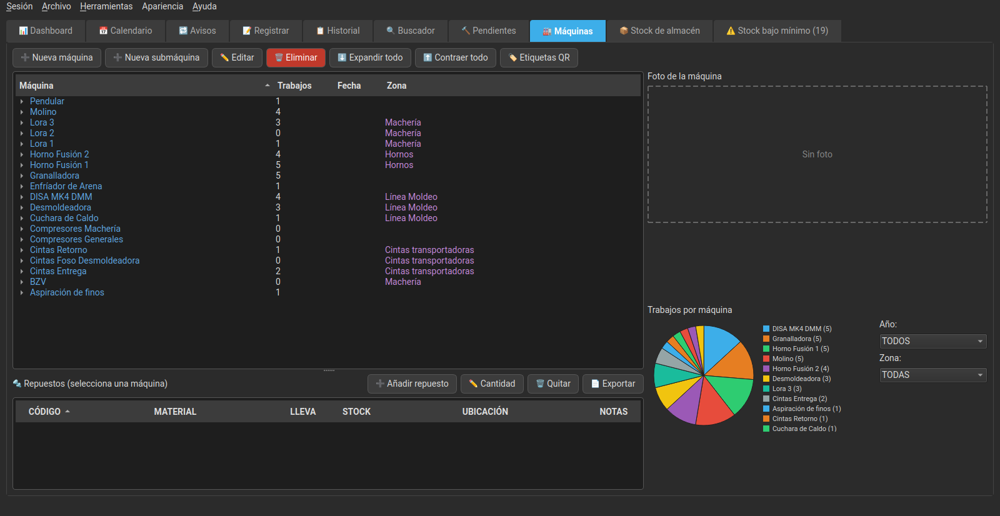

<p align="center">
  <a href="README.md"></a>
  <a href="README.es.md"></a>
  <a href="README.eu.md"></a>
  <a href="README.ca.md"></a>
  <a href="README.gl.md"></a>
  <a href="README.pt.md"></a>
  <a href="README.fr.md"></a>
</p>

# MantPro

<p align="center">
  
</p>

<p align="center">
  <strong>GMAO/CMMS gratuito y open source para gestionar el mantenimiento preventivo y correctivo de tu planta, taller o flota, desde PC y Android.</strong>
</p>

<p align="center">
  
  
  
  
  
  
</p>

---

## 📋 Índice

- [¿Qué problema resuelve?](#-qué-problema-resuelve)
- [¿Para quién es?](#-para-quién-es)
- [¿Por qué MantPro?](#-por-qué-mantpro-y-no-un-gmaocmms-comercial)
- [Vídeo de demostración](#-vídeo-de-demostración)
- [Capturas de Pantalla](#-capturas-de-pantalla)
- [Descargas](#-descargas)
- [Características](#-características)
- [Requisitos](#-requisitos)
- [Instalación](#-instalación)
- [Uso](#-uso)
- [Usuarios y Acceso](#-usuarios-y-acceso)
- [Maquinaria](#-maquinaria)
- [Stock de Almacén](#-stock-de-almacén)
- [Sincronización PC-Móvil](#-sincronización-pc-móvil)
- [Copias de Seguridad](#-copias-de-seguridad)
- [Contribuir](#-contribuir)
- [Hoja de ruta](#-hoja-de-ruta)
- [Licencia](#-licencia)
- [Contacto](#-contacto)

---

## 🧩 ¿Qué problema resuelve?

En muchos talleres y plantas pequeñas o medianas, el mantenimiento se lleva
entre papeles, un Excel compartido y mensajes de WhatsApp. Funciona, hasta que
alguien necesita saber **qué se le ha hecho a una máquina en concreto**, quién
lo hizo, cuándo y con qué material, y esa información está repartida entre
tres sitios distintos (o en ninguno).

**MantPro centraliza eso**: cada técnico registra su intervención desde el
móvil, en el momento, con fotos de antes y después si hace falta, y todo
queda ordenado en el PC por máquina, por fecha y por persona, listo para
consultarlo o sacar un informe en PDF.

## 🎯 ¿Para quién es?

Pensado para quien lleva el mantenimiento del día a día, no para departamentos
de IT: técnicos de mantenimiento, responsables de planta, talleres, PYMEs
industriales y encargados de almacén que necesitan un control real de
máquinas, intervenciones y stock sin depender de hojas de cálculo sueltas.

## 🆚 ¿Por qué MantPro y no un GMAO/CMMS comercial?

- **Open source y gratis**: código abierto bajo AGPL-3.0, sin límite de
  técnicos, máquinas o registros
- **Autoalojado: gratis para siempre**: instalado en tu propio PC o servidor, no se paga por usuario ni por mes de uso
- **Tus datos, en tu infraestructura**: la base de datos vive en tu propio PC;
  no dependes de que un servicio en la nube de terceros siga existiendo el año
  que viene
- **Offline de verdad**: el móvil funciona sin conexión a internet ni al PC
  durante toda la jornada, y sincroniza en cuanto vuelve a haber red
- **Hecho desde el propio mantenimiento**: las funciones han ido saliendo de
  necesidades reales de taller (fotos de antes/después, vínculo a máquina,
  stock de recambios, avisos recurrentes...), no de una lista de requisitos
  genérica de GMAO/CMMS

| | MantPro | GMAO/CMMS comercial habitual |
|---|---|---|
| **Precio** | Gratis (autoalojado) | Cuota mensual por usuario |
| **Usuarios, máquinas y registros** | Sin límite | Según el plan contratado |
| **Dónde están tus datos** | En tu PC o servidor | En la nube del proveedor |
| **App móvil sin conexión** | Toda la jornada | A menudo limitada o solo consulta |
| **Almacén de repuestos** | Incluido | Muchas veces como módulo aparte |
| **Código fuente** | Abierto (AGPL-3.0) | Cerrado |
| **Si el proveedor desaparece** | Sigues usándolo | Te quedas sin servicio |

*Comparación con el modelo habitual de los GMAO/CMMS comerciales en la nube; cada producto es distinto.*

## 🎬 Vídeo de demostración

https://github.com/user-attachments/assets/11572710-e0ba-4f8b-b914-0a959006d4fb

## 📸 Capturas de Pantalla

### Aplicación de Escritorio

<p align="center">
  
  
  
</p>

### Aplicación Móvil

<p align="center">
  
  
  
</p>

---

## 📦 Descargas

Puedes descargar las versiones precompiladas desde [GitHub Releases](https://github.com/AnabasaSoft/MantPro/releases):

- **Windows**: instalador (`MantPro_Setup_v….exe`) o ejecutable `.exe` suelto
- **Linux**: 
  - Binario ejecutable de Linux
  - AppImage portable
  - Paquetes `.deb` (Debian, Ubuntu…) y `.rpm` (Fedora, openSUSE…), firmados con GPG
  - También disponible en **AUR** (Arch User Repository)
  - También disponible en [**OBS**](https://build.opensuse.org/package/show/home:danitxu79/MantPro) (openSUSE Build Service) para openSUSE Tumbleweed y Slowroll
- **Android**: Archivos `.apk` para instalación directa
  - `MantPro.apk`: app de trabajos de mantenimiento
  - `MantProStock.apk`: app de stock de almacén

Las versiones marcadas como *pre-release* (`v3.10.2-dev`, `-rc.1`…) son de
pruebas: solo se ofrecen como actualización a quien ya tiene instalada una
versión de pruebas. Quien usa una versión estable solo recibe avisos de
versiones estables. Los cambios de cada versión están en
[CHANGELOG.md](CHANGELOG.md).

---

## ✨ Características

### 💻 Aplicación de Escritorio (PC)

- **👥 Gestión de Usuarios**: Login con usuario y contraseña, roles de administrador y técnico, alta y baja de usuarios, y restablecimiento de contraseñas
- **✍️ Autoría de los Trabajos**: Cada intervención guarda quién la realizó, visible en el historial y en los informes
- **🔒 Permisos por Registro**: un técnico solo puede editar o borrar sus propios trabajos; un administrador puede gestionar cualquiera, incluida la reasignación del autor de uno o varios registros a la vez
- **📋 Registro de Cambios**: quién cambió qué, cuándo y desde dónde (PC o móvil) en trabajos, pendientes, avisos, listas de comprobación, máquinas, almacén, usuarios, seguridad y configuración, con cada campo antes → después; filtros, buscador y exportación a Excel/CSV (solo administradores)
- **🔐 Sesiones de Dispositivos**: lista los móviles vinculados a cada usuario, con su modelo real, y permite revocar una o varias sesiones concretas sin desactivar al usuario entero (solo administradores). Al volver a iniciar sesión desde el mismo dispositivo, su sesión anterior se sustituye automáticamente en vez de acumularse
- **🛡️ Seguridad**: sincronización con los móviles cifrada por HTTPS (el certificado del PC queda fijado por el QR), **bases de datos cifradas** opcionales (SQLCipher, con la clave en el llavero del sistema) y **copias de seguridad cifradas con contraseña**, intentos de inicio de sesión limitados contra la fuerza bruta, fotos recibidas de los móviles comprobadas y copias consistentes con comprobación de integridad
- **📊 Dashboard con KPIs y Gráficos**: tarjetas de avisos pendientes, tareas por hacer, registros del mes y MTBF/MTTR medios de toda la planta, más gráficos de máquinas con más averías y de averías por mes, dibujados sin depender de librerías externas
- **🎨 Temas Visuales**: elige entre modo oscuro (por defecto), claro o un estilo retro inspirado en Windows 98, desde el menú "Apariencia"
- **📅 Calendario Interactivo**: Visualiza y gestiona tareas de mantenimiento con códigos de color (festivos, vacaciones, días con tareas)
- **📝 Historial Completo**: Registro histórico de todas las intervenciones realizadas, con fotos antes/después y una **colección de fotos** adicional por trabajo; se pueden borrar varios registros a la vez
- **📄 Reportes PDF**: Generación automática de informes profesionales con logo personalizable
- **📸 Gestión de Imágenes**: Almacenamiento y visualización de fotos de intervenciones
- **📱 Sincronización Móvil**: Servidor integrado (arranca automáticamente) para sincronización con la app móvil vía QR
- **🔍 Sistema de Búsqueda**: Búsqueda avanzada por fechas, tags y contenido
- **👤 Filtro por Técnico**: Filtra el historial y las exportaciones (PDF, CSV y Excel) por la persona que hizo el trabajo
- **📦 Backup/Restore**: copia manual completa (BD + fotos) eligiendo dónde guardarla, backup automático incremental al cerrar la app (ver [Copias de Seguridad](#-copias-de-seguridad)), y restauración con barra de progreso, con submenú `Archivo > Restaurar` para elegir entre un backup manual cualquiera o ir directo a las copias automáticas. Las copias se pueden **cifrar con contraseña** (`Archivo > 🔒 Contraseña de las copias…`)
- **🏷️ Sistema de Tags**: Categorización con etiquetas (Urgente, Eléctrico, Mecánico, Preventivo)
- **🔨 Tareas Pendientes**: Gestión de trabajos pendientes (crear, completar, editar, eliminar) y **asignación a un técnico concreto**
- **🚦 Prioridad de Pendientes**: cada trabajo pendiente tiene prioridad (Baja, Media, Alta o Crítica) para decidir cuál atacar primero, con su color en la lista; también se le pueden adjuntar fotos a su colección
- **↩️ Revertir a Pendiente**: si un trabajo se completó por error, se puede devolver a Pendientes con un clic desde el historial (con aviso si tenía máquina vinculada, ya que se perdería ese dato), quedando registrado en la auditoría
- **🔁 Recordatorios**: Avisos de mantenimiento que se repiten automáticamente. Si se pasa la fecha no se saltan: se quedan en **Pendiente** (naranja) mientras dura el margen y luego en **Atrasado** (rojo) hasta que se hacen, y la siguiente fecha se cuenta desde el día real en que se hizo el trabajo
- **☑️ Listas de comprobación**: plantillas reutilizables («Revisión mensual de compresor») con puntos que se marcan bien / mal / no aplica y lecturas con su unidad y su rango correcto (fuera de rango, «mal» automáticamente); se asignan a avisos y pendientes y se rellenan al completarlos, en el PC o en el móvil (también sin conexión). Se guardan con el trabajo, se ven en el historial y salen en las exportaciones a PDF, Excel y CSV
- **📦 Control de Stock de Almacén**: Estructura de estanterías, baldas y secciones configurable, ficha de materiales con foto, entradas/salidas con historial y alertas de stock bajo mínimo
- **📄 Exportar el Stock**: botón "📄 Exportar" en la pestaña de stock para sacar el almacén entero, una zona o una estantería a PDF, CSV o Excel, ordenado por ubicación; la pestaña de stock bajo mínimo también tiene su botón para exportar solo los materiales en alerta
- **🗑️ Tiempo Máximo de Guardado**: `Herramientas` permite borrar del historial los trabajos más antiguos que un número de años, meses o días, con sus fotos y una copia de seguridad previa (solo administradores)
- **📥 Importar desde Excel/CSV**: `Archivo > Importar desde Excel/CSV…` (solo administradores) trae máquinas, artículos del almacén, avisos recurrentes y usuarios desde una plantilla descargable o desde tu propio Excel (una hoja o el libro entero de una vez), emparejando solas las columnas, con vista previa fila a fila y copia de seguridad previa. Las ubicaciones (zonas, estanterías, baldas) y máquinas superiores que no existan se crean solas, y los usuarios reciben una contraseña temporal que tendrán que cambiar al entrar
- **🏭 Control de Maquinaria**: Árbol de máquinas y submáquinas con foto adjunta, contador de trabajos por año y mes, y vínculo directo desde cada trabajo registrado o editado (ver [Maquinaria](#-maquinaria))
- **📊 Exportación**: A PDF, CSV y Excel, con filtro opcional por técnico e indicando la máquina/submáquina de cada trabajo, si la tiene
- **📖 Ayuda integrada**: `Ayuda > 📖 Instrucciones` abre un manual completo por apartados (primeros pasos, usuarios, cada pestaña, menús, apps del móvil y problemas frecuentes), con índice y buscador, en los 7 idiomas. Con **F1** se abre directamente en el apartado de la pestaña en la que estás
- **👥 Estadísticas por Técnico**: botón en el Dashboard con los trabajos de cada técnico por año y mes, averías, preventivos, horas de parada y pendientes asignados ahora mismo, con gráfico de barras; filtrable por tipo (todos, trabajos y averías o mantenimiento preventivo) y exportable a PDF (con logo) y Excel
- **🔩 Repuestos por Máquina**: qué artículos del almacén lleva cada máquina y cuántos, con su stock y ubicación, y en qué máquinas se usa cada artículo (ver [Maquinaria](#-maquinaria))
- **💶 Repuestos Usados y su Coste**: al registrar, completar o editar un trabajo se apuntan los repuestos usados (se proponen primero los de la máquina); salen del stock y quedan guardados con el trabajo y el precio de ese momento, así que el coste no cambia aunque luego cambie el precio. Al corregirlos se ajusta el stock. Cada artículo puede tener precio unitario (moneda configurable). `Máquinas > 💶 Coste de repuestos` muestra el coste por máquina, con sus submáquinas, por año y exportable a Excel; el historial, el PDF, el Excel y el CSV los incluyen
- **⏱️ Tiempo Trabajado**: cuánto duró cada trabajo y cuántas personas, **apuntado después** (sin cronómetro: en una avería primero se arregla), en el PC o en el móvil, también al completar avisos y pendientes, y corregible en el historial. Con un coste de la hora interno (solo administradores; cada trabajo guarda la tarifa del momento), `Máquinas > 💶 Costes` muestra horas, mano de obra, repuestos y total por máquina, y las estadísticas por técnico incluyen sus horas
- **🏷️ Etiquetas QR por Máquina**: PDF de etiquetas para pegar en las máquinas; al escanearlas con la app MantPro se abre la ficha de la máquina
- **🔍 Aviso de Repetidos**: al crear o renombrar una máquina, o al crear o editar un artículo, avisa si ya hay otro con el mismo código o un nombre igual o muy parecido (por ejemplo «Extractor de finos» / «Extracción de finos»), sin avisar cuando solo cambia el número («Lora 1» / «Lora 2»)
- **📲 Instalar las Apps con un QR**: `Herramientas > 📱 Instalar MantPro en móvil` y `📦 Instalar MantPro Stock en móvil` muestran un QR que, al escanearlo con la cámara del móvil, descarga la última versión estable de la app
- **🔔 Avisos de Actualización**: `Ayuda > 🔄 Buscar Actualizaciones` avisa de las nuevas versiones; la instalada desde OBS (openSUSE) indica que se actualiza con `zypper`

### 📱 Aplicación Móvil (Android)

- **🔐 Acceso con Usuario**: Cada técnico inicia sesión una vez y la sesión queda guardada en el dispositivo (el token se guarda en el Keystore de Android, no en claro)
- **📝 Registro Rápido**: Captura de intervenciones sobre el terreno, firmadas automáticamente con su usuario
- **📷 Cámara Integrada**: Toma de fotos y edición con anotaciones
- **🖼️ Colección de Fotos**: además de las fotos de antes y después, añade a un trabajo o pendiente todas las fotos que quieras (cámara o galería); al tocar cualquier foto se ve a pantalla completa, pasando de una a otra y ampliando con dos dedos
- **✏️ Editor de Imágenes**: Dibuja sobre las fotos para marcar áreas de interés
- **🔄 Sincronización Automática**: Envío automático de datos al PC mediante código QR
- **💾 Almacenamiento Local**: Guarda registros offline hasta sincronizar
- **📋 Trabajos Pendientes**: Visualiza y gestiona tareas asignadas desde el PC, con filtro **"Solo míos"**
- **🔄 Puesta al Día al Abrir**: Al arrancar, la app sincroniza en segundo plano los datos de todas las pestañas
- **🔁 Resincronizar a Mano**: Las pestañas Pendientes, Historial y Recordatorios tienen su propio botón para reenviar de inmediato lo que el móvil tenga y el PC todavía no
- **↩️ Revertir a Pendiente**: manteniendo pulsado un registro del Historial se puede devolver a la pestaña Pendientes si se completó por error
- **🏷️ Tags Rápidos**: Sistema de etiquetado rápido con checkboxes
- **☑️ Listas de comprobación**: los avisos y pendientes con lista piden rellenarla al completarlos (bien / mal / no aplica y lecturas), también sin conexión; el historial muestra la lista rellenada
- **🔌 Modo Offline**: Trabaja sin conexión y sincroniza cuando estés disponible
- **⏰ Recordatorios Diarios**: Notificación automática a las 8:00 AM (hora local) si hay trabajos pendientes sin completar
- **🧰 Material Usado**: Añade al trabajo el material del almacén que has empleado, buscándolo por nombre o código; se descuenta solo del stock al guardar (ver [Material usado en un trabajo](#-stock-de-almacén)). Al completar un aviso también se pueden apuntar repuestos, salen primero los de la máquina, y al corregir un trabajo del historial se ajusta el stock
- **🏭 Vincular Máquina**: Selecciona en un desplegable la máquina o submáquina en la que se ha hecho el trabajo, tanto al crear un registro nuevo como al editar uno ya sincronizado del historial
- **🔄 Conectada en Segundo Plano**: mientras la app está abierta, aunque sea en segundo plano, sigue sincronizando con el PC y muestra una notificación («Conectado al PC» / «Sin conexión con el PC») con un botón «Cerrar». Al cerrarla del todo deja de gastar batería
- **📶 Primera Sincronización con Progreso**: barra de progreso al descargar los datos y las fotos, con descarga en paralelo para que sea más rápida
- **🏷️ Escanear la Máquina**: el botón de escanear lee la etiqueta QR de una máquina y abre su ficha, sin conexión: dónde está, sus últimos trabajos, sus **repuestos** con el stock del almacén, y un botón para registrar un trabajo ya vinculado a ella
- **⬆️ Actualizar desde la App**: cuando hay una versión nueva, el aviso tiene los botones «Después» y «Actualizar»; «Actualizar» descarga el APK con una barra de progreso y abre el instalador de Android, sin pasar por GitHub

### 📦 Aplicación Móvil de Stock (Android)

Aplicación independiente (`mantpro_stock_app`), pensada para consultar y mover
stock de almacén desde el móvil sin necesidad de la app de trabajos.

- **🔐 Acceso con Usuario**: usa el mismo sistema de usuarios y sesión que la app de trabajos (el token se guarda en el Keystore de Android, no en claro)
- **🗂️ Navegación del Almacén**: árbol de estanterías > baldas > secciones, igual que en el PC
- **🔎 Búsqueda de Materiales**: por nombre, código, descripción o ubicación
- **➕➖ Entradas y Salidas**: registra movimientos de stock desde el móvil, con motivo opcional
- **🔀 Traslados**: mover un material de sección queda reflejado en su historial de movimientos
- **🎨 Aviso Visual de Stock**: cantidad en rojo por debajo del mínimo, en verde por encima y en el color por defecto si coincide exactamente
- **⚠️ Stock Bajo Mínimo**: pestaña dedicada a los materiales en alerta
- **🔄 Auto-actualización**: la pantalla se refresca sola al detectar cambios, tanto si el cambio se hizo en el propio móvil como en el PC
- **🔌 Modo Offline**: sin conexión con el PC la app no se queda esperando: consulta los datos guardados y deja registrar altas, ediciones, entradas y salidas al momento, que se envían solas al PC en cuanto vuelve a estar accesible
- **🔔 Recordatorio Diario de Comprobación de Stock**: notificación automática a las 8:00 AM (hora local) invitando a revisar la cantidad real de 5 materiales del almacén, elegidos al azar y distintos cada día; al pulsarla se abre una pantalla para corregir la cantidad de cada uno sin buscarlos a mano. Si no hay ningún material dado de alta, no se muestra ninguna notificación
- **🔄 Conectada en Segundo Plano**: como MantPro, sigue sincronizando en segundo plano, con su notificación; el icono de usuario se pone **verde** si hay conexión con el PC y **rojo** si no
- **🔩 Se Usa En**: cada artículo muestra en qué máquinas se usa como repuesto y cuántos lleva cada una, también sin conexión
- **🔍 Aviso de Repetidos**: al crear o editar un artículo avisa si ya hay otro con el mismo código o un nombre muy parecido, comparando con los artículos guardados en el móvil (funciona sin conexión)
- **⬆️ Actualizar desde la App**: igual que MantPro, descarga e instala la nueva versión desde el propio aviso

---

## 🔧 Requisitos

### Aplicación de Escritorio

- **Python**: 3.10 o superior
- **Sistema Operativo**: Windows o Linux
- **Dependencias Python**:
  - PyQt6
  - Flask
  - ReportLab
  - qrcode
  - requests
  - xlsxwriter
  - openpyxl
  - Pillow
  - cryptography
  - keyring y sqlcipher3-wheels (opcionales: cifrado de las bases de datos)
  - sqlite3 (incluido en Python)

### Aplicación Móvil

Aplica tanto a `mantenimiento_app` (trabajos) como a `mantpro_stock_app` (stock):

- **Flutter**: 3.0 o superior
- **Dart SDK**: 2.17 o superior
- **Android**: API Level 24+ (Android 7.0+)

---

## 📥 Instalación

### Aplicación de Escritorio

#### Opción 1: Descarga Precompilada (Recomendado)

Descarga la versión correspondiente a tu sistema desde [GitHub Releases](https://github.com/AnabasaSoft/MantPro/releases):

- **Windows**: Descarga y ejecuta el `.exe`
- **Linux**: 
  - Descarga el binario ejecutable y dale permisos de ejecución: `chmod +x mantpro`
  - O usa el **AppImage** (sin instalación): `chmod +x MantPro.AppImage && ./MantPro.AppImage`
  - Los paquetes **`.deb`** y **`.rpm`** están firmados digitalmente con GPG (ver [Verificar la firma de los paquetes](#-verificar-la-firma-de-los-paquetes-linux))
  - **Arch Linux**: Disponible en AUR: `yay -S mantpro` o `paru -S mantpro`
  - **openSUSE Tumbleweed / Slowroll**: disponible en [OBS](https://build.opensuse.org/package/show/home:danitxu79/MantPro), compilado con el Python y el PyQt6 de la propia distribución y actualizado con `zypper`:
    ```bash
    sudo zypper ar -f https://download.opensuse.org/repositories/home:/danitxu79/openSUSE_Tumbleweed/home:danitxu79.repo
    sudo zypper in mantpro
    ```
    (en Slowroll, cambia `openSUSE_Tumbleweed` por `openSUSE_Slowroll` en la URL)

#### 🔏 Verificar la firma de los paquetes (Linux)

Los paquetes `.deb` y `.rpm` publicados en cada release están firmados con la clave GPG oficial de AnabasaSoft. Para verificarlos antes de instalar:

**Huella de la clave** (compruébala también en [anabasasoft.github.io](https://anabasasoft.github.io/about.html#firma)): `11C7 C6C8 127D FE48 33DE  30EF 9D7A AEC8 1842 C199` (RSA 4096, caduca el 2028-10-06). Si la que te muestra `gpg` no coincide exactamente, no instales el paquete.

1. Descarga la clave pública del repositorio ([`firma/anabasasoft_public.asc`](firma/anabasasoft_public.asc)) a un fichero (**no uses `curl | rpm --import -`**, algunas versiones de `rpm` no admiten leer la clave por la entrada estándar y fallan con `falló la lectura para importar`):
   ```bash
   curl -sL https://raw.githubusercontent.com/AnabasaSoft/MantPro/main/firma/anabasasoft_public.asc -o /tmp/anabasasoft_public.asc
   ```

2. Importa la clave (solo hace falta una vez por equipo):
   ```bash
   # Fedora, openSUSE, RHEL... (paquete .rpm)
   sudo rpm --import /tmp/anabasasoft_public.asc

   # Debian, Ubuntu... (paquete .deb, requiere dpkg-sig)
   gpg --import /tmp/anabasasoft_public.asc
   ```

3. Comprueba que la clave se ha importado correctamente:
   ```bash
   # RPM
   rpm -qa 'gpg-pubkey*' --qf '%{name}-%{version}-%{release} --> %{summary}\n' | grep -i anabasasoft

   # DEB (o cualquier distribución con gpg): muestra también la huella
   gpg --fingerprint AnabasaSoft
   ```

4. Verifica la firma del paquete descargado:
   ```bash
   # RPM
   rpm --checksig mantpro-*.rpm

   # DEB
   dpkg-sig --verify mantpro_*.deb
   ```
   Una firma correcta muestra `OK` en la línea de la firma (en vez de `NOKEY` o `MISSING KEYS`).

Una firma válida confirma que el paquete procede de AnabasaSoft y no ha sido modificado.

#### Opción 2: Instalación desde Código Fuente

1. **Clonar el repositorio**:
   ```bash
   git clone https://github.com/AnabasaSoft/MantPro.git
   cd MantPro
   ```

2. **Crear entorno virtual** (recomendado):
   ```bash
   python -m venv venv
   source venv/bin/activate  # En Windows: venv\Scripts\activate
   ```

3. **Instalar dependencias**:
   ```bash
   pip install -r requirements.txt
   ```

4. **Ejecutar la aplicación**:
   ```bash
   python main.py
   ```

### Aplicación Móvil

#### Opción 1: Descarga Directa (Recomendado)

Descarga el `.apk` correspondiente desde [GitHub Releases](https://github.com/AnabasaSoft/MantPro/releases) e instálalo en tu dispositivo Android: `MantPro.apk` para trabajos, `MantProStock.apk` para el stock de almacén. Son apps independientes y puedes instalar una, otra o ambas.

**Nota**: Es posible que necesites habilitar "Orígenes desconocidos" en la configuración de seguridad de tu dispositivo.

**Desde el PC, con un QR**: en `Herramientas > 📱 Instalar MantPro en móvil`
(o `📦 Instalar MantPro Stock en móvil`) aparece un QR. Escanéalo con la cámara
del móvil, abre el enlace y se descarga la última versión estable de la app.
Una vez instaladas, las apps avisan de las nuevas versiones y se actualizan
desde el propio aviso con el botón «Actualizar».

#### Opción 2: Compilar desde Código Fuente

1. **Navegar al directorio móvil** (`mantenimiento_app` para trabajos, `mantpro_stock_app` para stock):
   ```bash
   cd mantenimiento_app
   ```

2. **Instalar dependencias**:
   ```bash
   flutter pub get
   ```

3. **Ejecutar en dispositivo/emulador**:
   ```bash
   flutter run
   ```

4. **Compilar APK (Android)**:
   ```bash
   flutter build apk --release
   ```

---

## 🚀 Uso

### Primera Configuración

#### Aplicación de Escritorio

1. **Iniciar la aplicación**: Ejecuta `python main.py` (el servidor de sincronización arranca solo, no hace falta iniciarlo a mano)
2. **Primer acceso**: En el primer arranque se crea el usuario `admin` con contraseña `admin`. La aplicación **obliga a cambiarla** al entrar
3. **Crear los usuarios**: Menú `Herramientas` > `👥 Gestión de usuarios` > da de alta a cada técnico
4. **Configurar logo** (opcional): Menú `Archivo` > `📤 Exportar` > `📄 Opciones PDF` > `🖼️ Añadir / Cambiar Logo`
5. **Registrar un trabajo**: Pestaña "📝 Registrar" > rellena resumen/detalles > "💾 GUARDAR REGISTRO"
6. **Crear un pendiente**: Pestaña "🔨 Pendientes" > grupo "Nuevo Trabajo" (Título + Detalles + "Asignar a") > "Añadir"

#### Aplicación Móvil

1. **Instalar la app** en tu dispositivo móvil
2. **Conectar con PC**:
   - Asegúrate de que el PC y el móvil están en la misma red WiFi
   - En el PC: Menú `Herramientas` > `📲 Sincronizar App (QR)`
   - En el móvil: Tap en "Vincular PC" y escanea el código
3. **Iniciar sesión**: Introduce el usuario y la contraseña que te haya creado el administrador. La sesión queda guardada: solo hay que hacerlo una vez
4. **Listo**: Ya puedes registrar intervenciones desde el móvil

### Flujo de Trabajo Típico

#### Desde el PC

1. **Crear y asignar una tarea pendiente**:
   - Pestaña "🔨 Pendientes" > grupo "Nuevo Trabajo" > rellena Título y Detalles, elige el técnico en "Asignar a" > "Añadir"
   - Gestiónala con los botones "✅ Completar", "✏️ Editar", "❌ Eliminar" o "👤 Reasignar"
   - El desplegable "Ver los de" filtra la lista por técnico (incluye "Sin asignar")

2. **Revisar trabajos completados**:
   - Los trabajos sincronizados desde el móvil aparecen automáticamente
   - Revisa fotos (antes/después) y detalles en la pestaña "🗂 Historial" o en el "📅 Calendario"
   - La columna "Realizado por" indica quién hizo cada trabajo, y el desplegable de arriba permite ver solo los de una persona

3. **Generar reportes**:
   - Menú `Archivo` > `📤 Exportar` > `📄 Opciones PDF` > `📄 Generar PDF Ahora`
   - En el diálogo puedes elegir el técnico, y su nombre aparece en el título del informe
   - O exporta a `📄 CSV` / `📊 Excel` desde `Archivo` > `📤 Exportar`

#### Desde el Móvil

1. **Vincular con el PC e iniciar sesión** (solo la primera vez, o si cambias de red):
   - Tap en "Vincular PC" y escanea el QR que muestra el PC
   - Introduce tu usuario y contraseña
   - El móvil guarda la dirección del PC y tu sesión para sincronizar automáticamente a partir de ahí

2. **Registrar intervención**:
   - Tap en "Nuevo" o selecciona un trabajo pendiente ya sincronizado desde el PC
   - Con el chip "Solo míos" ves únicamente los trabajos que te han asignado
   - Completa título y detalles
   - Toma foto "antes" y, opcionalmente, foto "después" con la cámara
   - Dibuja/anota sobre la foto si es necesario
   - Selecciona tags apropiados
   - Guarda

3. **Sincronizar**:
   - Al abrir la app se sincroniza todo en segundo plano (verás un indicador en la barra superior)
   - También puedes forzarlo tirando de la lista hacia abajo o con el icono de sincronización
   - Los registros se envían al PC y se eliminan del móvil al confirmar el envío
   - Todo funciona sin conexión: lo pendiente se guarda y se sube cuando hay cobertura

---

## 👥 Usuarios y Acceso

### Roles

Un mismo usuario puede tener **uno o varios roles a la vez** (por ejemplo,
técnico y almacén). Roles disponibles:

| Rol | Puede hacer |
|-----|-------------|
| **Administrador** | Todo lo del técnico y lo de almacén, más dar de alta y de baja usuarios, cambiar roles, restablecer contraseñas, editar o borrar **cualquier** registro del historial, reasignar el autor de uno o varios registros a la vez, y consultar el registro de auditoría de cambios |
| **Técnico** | Registrar trabajos, completar pendientes y avisos, editar o borrar **solo sus propios** registros del historial, y cambiar su propia contraseña |
| **Almacén** | Dar de alta o editar materiales y registrar entradas/salidas de stock desde la app móvil **MantPro Stock** |

Siempre debe quedar **al menos un administrador activo**: la aplicación impide
quitarle el rol o desactivarlo al último que queda.

> Desde la aplicación de escritorio, cualquier usuario (sea cual sea su rol)
> puede registrar movimientos de stock; el rol **Almacén** es lo que habilita
> esa misma gestión (altas, ediciones y movimientos) desde el móvil.

### Gestión desde el PC

- **Alta**: `Herramientas` > `👥 Gestión de usuarios` > rellena usuario, nombre,
  contraseña y rol > "➕ Añadir". Si dejas marcado "Pedir cambio al entrar", la
  persona tendrá que definir su propia contraseña en el primer acceso.
- **Baja**: se hace de forma **lógica** (el usuario queda inactivo). Nunca se
  borra, para no romper la autoría de los trabajos que ya hizo.
- **Restablecer contraseña**: útil cuando alguien la olvida. Al cambiarla se
  cierran automáticamente todas las sesiones abiertas de esa persona en el móvil.
- **Cambiar la propia contraseña**: `Herramientas` > `🔑 Cambiar mi contraseña`.

### Sesiones de dispositivos

`Herramientas` > `🔐 Sesiones de dispositivos` (solo administradores) lista
todas las sesiones abiertas en el móvil de todos los usuarios, con el modelo
del dispositivo, cuándo se inició, cuándo expira y si sigue activa o ya
expiró. Se pueden seleccionar una o varias filas a la vez y revocarlas, lo que
cierra la sesión de ese móvil sin necesidad de desactivar al usuario entero
(que cerraría *todos* sus dispositivos de golpe).

Si un usuario vuelve a iniciar sesión desde un dispositivo con el que ya tenía
una sesión abierta (mismo fabricante y modelo), la sesión anterior de ese
dispositivo se borra automáticamente al crear la nueva, en vez de quedarse
acumulada como una sesión suelta más en el listado.

La columna **Conexión** indica si cada móvil está **en línea** ahora mismo y
cuándo fue su último contacto. Las apps avisan al PC cada pocos segundos
mientras están abiertas (también en segundo plano), y al cerrarlas del todo
avisan de que se desconectan, así que el estado se actualiza al momento.

### Autoría de los trabajos

Cada registro guarda el técnico que lo hizo, tanto si se creó en el PC como si
llegó del móvil. Los registros anteriores a la implantación del sistema de
usuarios quedaron marcados como **`Histórico`**.

En el móvil, la atribución la decide **siempre el servidor** a partir del token
de la sesión, nunca un dato enviado por la app. Un dispositivo no puede firmar
trabajos en nombre de otra persona.

Desde el PC, un técnico solo puede editar o borrar sus propios registros del
historial; un administrador puede hacerlo con cualquiera. Con clic derecho sobre
una o varias filas del historial (selección múltiple con Ctrl/Shift), un
administrador puede además **reasignar el autor** en bloque, quedando cada
cambio anotado en el registro de auditoría.

### Registro de cambios (auditoría)

Los administradores ven en `Herramientas` > `📋 Registro de cambios` **quién
cambió qué, cuándo y desde dónde** (el PC o qué móvil): trabajos, pendientes,
avisos, listas de comprobación, máquinas y repuestos, artículos y estructura del
almacén, usuarios y especialidades, seguridad (sesiones revocadas, bloqueos por
intentos fallidos, cifrado, conexión sin cifrar), copias restauradas,
importaciones y configuración. Cada cambio muestra los campos afectados
**antes → después**. Se puede filtrar por categoría, acción, usuario y periodo,
buscar por texto y exportar a Excel o CSV.

### Sesión en el móvil

El técnico inicia sesión una vez y el token queda guardado en el dispositivo. La
sesión se cierra sola si el administrador desactiva al usuario o le restablece la
contraseña; en ese caso la app vuelve a la pantalla de acceso **sin perder los
registros que aún estén pendientes de subir**.

El token de sesión se guarda en el **Keystore de Android** (almacenamiento seguro), no en claro. Tras **5 intentos fallidos** seguidos de inicio de sesión, ese usuario se bloquea 15 minutos (y un móvil, tras 20 intentos fallidos); la app muestra cuánto hay que esperar. En la ventana del PC, 5 fallos bloquean el inicio de sesión un minuto.

---

## 🏭 Maquinaria

> Gestión disponible desde la aplicación de escritorio, con el vínculo a la
> máquina también seleccionable desde el móvil al registrar o editar un
> trabajo.

Pestaña "🏭 Máquinas" del PC, pensada para llevar el control de averías e
intervenciones de cada equipo a lo largo del tiempo.

- **🌳 Árbol de maquinaria**: las máquinas pueden tener submáquinas (por
  ejemplo, una línea con varios equipos), formando una jerarquía tan profunda
  como haga falta
- **📅 Trabajos organizados por año y mes**: al expandir una máquina se ven los
  años con trabajos, y al expandir un año, los meses; cada nivel muestra un
  contador de cuántos trabajos tiene, con carga bajo demanda para no ralentizar
  el árbol
- **🖱️ Acceso directo al trabajo**: haciendo doble clic sobre un trabajo del
  árbol se abre directamente su ficha de edición
- **📸 Foto de la máquina**: cada máquina o submáquina puede tener una foto
  adjunta, visible en un recuadro junto al árbol al seleccionarla
- **🔗 Vínculo desde cada trabajo**: al registrar un trabajo nuevo (PC o móvil)
  o editar uno existente se puede elegir a qué máquina/submáquina pertenece
- **📊 En las exportaciones**: la máquina o submáquina vinculada aparece como
  columna adicional en las exportaciones a PDF, CSV y Excel
- **🗺️ Zona heredada**: al crear una submáquina, toma por defecto la zona de
  su máquina superior
- **🔩 Repuestos de cada máquina**: debajo del árbol se ven los artículos del
  almacén que lleva la máquina seleccionada, cuántos lleva, su stock (en rojo
  si está bajo mínimo), su ubicación y una nota (por ejemplo «lado motor»). Se
  añaden con «➕ Añadir repuesto», se exportan a PDF o Excel, y con doble clic
  se salta al artículo en el almacén
- **🏷️ Etiquetas QR**: el botón «🏷️ Etiquetas QR» genera un PDF de folios A4
  con 24 etiquetas de 70 × 37 mm (de la máquina seleccionada, con sus
  submáquinas o de todas). Al escanearlas con la app MantPro se abre la ficha
  de la máquina
- **🔍 Nombres parecidos**: al crear o renombrar una máquina, avisa si al mismo
  nivel ya hay otra con un nombre igual o muy parecido

---

## 📦 Stock de Almacén

> Gestión completa desde la aplicación de escritorio, con consulta y
> movimientos también disponibles desde el móvil (`mantpro_stock_app`). Vive
> en su propia base de datos (`almacen.db`), independiente de la de los
> trabajos de mantenimiento.

### Estructura del almacén

El almacén se organiza en tres niveles, inspirados en las convenciones
habituales de codificación de ubicaciones de almacén:

```
Estantería → Balda → Sección
```

- Al crear una estantería se define el **número de baldas**, el **número de
  secciones por balda** (0 = sin secciones predefinidas, se pueden añadir
  luego) y si tiene **hueco en el suelo** bajo la balda inferior, que se
  gestiona como una balda especial ("Suelo")
- Las baldas se numeran de abajo a arriba empezando en 1, para poder añadir
  baldas nuevas sin tener que renumerar las existentes
- No se puede eliminar una estantería, balda o sección mientras contenga
  material ubicado

La estructura se gestiona desde el botón **"⚙️ Configurar almacén"** de la
pestaña "📦 Stock de almacén", visible **solo para administradores**.

### Materiales

- Alta y edición con código (opcional), nombre, descripción, unidad, stock
  mínimo, ubicación (estantería / balda / sección) y **foto adjunta**
- Búsqueda por **nombre, código, descripción o ubicación**
- El stock se resalta en **rojo** por debajo del mínimo, en **verde** por
  encima y en el color por defecto si coincide exactamente con el mínimo,
  tanto en el PC como en el móvil
- Seleccionando varios materiales a la vez (Ctrl/Shift + clic derecho) en el
  PC se pueden **mover de ubicación** o **eliminar** en bloque
- Cada material indica **en qué máquinas se usa** como repuesto, y al crearlo
  o editarlo se le pueden asociar máquinas directamente, con la cantidad que
  lleva cada una
- Al crear o editar un material se avisa si ya hay otro con el **mismo código
  o un nombre muy parecido**, para no darlo de alta dos veces

### Entradas, salidas y traslados

- **Cualquier usuario** puede registrar entradas y salidas de stock; solo la
  configuración de la estructura del almacén está restringida a administradores
- Cada movimiento queda registrado con fecha, cantidad, usuario y un motivo
  opcional, visible en el historial junto a cada material
- Las salidas registradas a mano (PC o `mantpro_stock_app`) no pueden dejar
  el stock en negativo
- Cambiar la ubicación de un material también queda registrado en su
  historial, como un movimiento de tipo **traslado** (de qué sección a qué
  sección)
- El botón **«📜 Historial»** muestra todos los movimientos del almacén
  seguidos (entradas, salidas y traslados), con el nombre de cada artículo y
  filtros por texto y tipo

### Material usado en un trabajo (MantPro)

Al completar un trabajo desde la app **MantPro** (móvil), se puede añadir el
material que se ha empleado buscándolo por nombre o código e indicando la
cantidad. Al guardar el trabajo, ese material se descuenta automáticamente
del almacén, con el motivo "Usado en trabajo: ..." para mantener la
trazabilidad.

A diferencia de las salidas manuales, **este descuento sí puede dejar el
stock en negativo**: el material ya se ha usado físicamente para hacer el
trabajo aunque no hubiera stock registrado suficiente, así que bloquear el
movimiento no tendría sentido. El stock negativo se verá tanto en el PC
como en `mantpro_stock_app`, y sirve como aviso de que hay que comprobar y
reponer ese material cuanto antes.

### Alertas de stock bajo mínimo

La pestaña **"⚠️ Stock bajo mínimo"** muestra, en una vista aparte, los
materiales sin stock o por debajo del mínimo establecido. El propio título de
la pestaña indica cuántos materiales están en alerta, y desde ahí se puede
saltar directamente al material en "Stock de almacén" o registrar una entrada
sin cambiar de pestaña, o exportar la lista con el botón "📄 Exportar".

### Exportar el stock

En la pestaña **"📦 Stock de almacén"** del PC, el botón **"📄 Exportar"** abre
una ventana para elegir el **formato** (PDF, CSV o Excel) y **qué exportar**:
todo el almacén, una zona o una sola estantería. La lista sale ordenada por
ubicación, para poder recorrer el almacén con ella en la mano; el PDF y el
Excel incluyen además la fecha, el número de materiales y cuántos están bajo
el mínimo (en rojo). La propia tabla de stock también se muestra ordenada por
ubicación por defecto (Estantería 1, 2… 10).

---

## 🔄 Sincronización PC-Móvil

### Cómo Funciona

MantPro utiliza un sistema de sincronización basado en:

1. **Servidor Flask** integrado en la app de escritorio
2. **Códigos QR** para conexión rápida y segura
3. **API REST autenticada por token**: todos los endpoints de datos exigen una
   sesión válida; si el token deja de valer, el servidor responde `401` y el
   móvil vuelve al login
4. **WiFi local** - sin necesidad de internet
5. **Sincronización completa al abrir la app**, en segundo plano y sin bloquear
   la interfaz
6. Mientras las apps del móvil están abiertas, aunque sea en segundo plano,
   siguen sincronizando y el PC las ve **en línea** en `Herramientas > 🔐
   Sesiones de dispositivos`
7. La primera sincronización muestra una **barra de progreso** y descarga los
   datos en paralelo y las fotos de 4 en 4

> 🔒 La sincronización va **cifrada (HTTPS)**. El PC crea su propio certificado
> y su huella viaja en el QR: el móvil solo se conecta a *ese* PC, así que nadie
> en la WiFi puede leer el tráfico ni hacerse pasar por él. Los móviles ya
> vinculados pasan solos a HTTPS al actualizar la app.

### Configuración de Red

Para que la sincronización funcione:

- ✅ PC y móvil deben estar en la **misma red WiFi**
- ✅ El **firewall** debe permitir conexiones en el puerto 5000 (o el configurado)
- ✅ También debe permitir el **puerto siguiente** (5001 por defecto), que usa la conexión cifrada (HTTPS)
- ✅ Si usas Windows, puede que necesites crear una excepción de firewall

### Solución de Problemas

**El móvil no conecta con el PC:**
- Verifica que ambos dispositivos están en la misma red
- Comprueba que el servidor está activo en el PC (icono verde)
- Prueba a desactivar temporalmente el firewall del PC
- Regenera el código QR y vuelve a escanearlo

**No puedo iniciar sesión desde el móvil:**
- Comprueba que MantPro está abierto en el PC: el login se valida contra él
- Verifica el usuario y la contraseña con el administrador; puede restablecerla
- Si el PC ha cambiado de IP, vuelve a escanear el QR desde el propio login ("Vincular otro PC")

**La app me ha devuelto a la pantalla de acceso:**
- Es normal si el administrador ha restablecido tu contraseña o ha desactivado tu usuario
- Tus registros sin subir **no se pierden**: vuelve a entrar y se sincronizan

**He olvidado la contraseña de administrador:**
- Otro administrador puede restablecerla desde `Herramientas` > `👥 Gestión de usuarios`
- Si no hay ningún otro administrador, hay que restablecerla directamente sobre
  la tabla `usuarios` de la base de datos

**Las fotos no se sincronizan:**
- Verifica que hay espacio suficiente en el disco del PC
- Comprueba los permisos de la carpeta `fotos_recibidas`
- Asegúrate de que la foto se guardó correctamente en el móvil

**No me llega la notificación diaria de avisos pendientes (Android):**
- Comprueba que el permiso de notificaciones está concedido: `Ajustes → Apps → MantPro → Notificaciones`
- En fabricantes como **OPPO/Realme (ColorOS), Xiaomi (MIUI) o Huawei**, el sistema puede matar la alarma programada aunque el permiso esté dado. Hay que además:
  - `Ajustes → Batería → Uso de batería por app → MantPro` → ponerlo en **"Sin restricciones"**
  - `Ajustes → Batería → Inicio automático` → **activar** MantPro
- La notificación se reevalúa cada vez que abres el Dashboard, así que si acabas de marcar un trabajo como completado, ábrelo de nuevo para que se cancele/reprograme correctamente.

**No me llega la notificación diaria de comprobación de stock (MantPro Stock):**
- Se aplican las mismas comprobaciones que en MantPro (permiso de notificaciones y exclusión de la optimización de batería, ver arriba)
- Si el almacén no tiene ningún material dado de alta, no se muestra ninguna notificación: es el comportamiento esperado
- Se reevalúa cada vez que la app sincroniza con el PC (al abrir y cada 25 segundos mientras está abierta)

**MantPro pide una clave de recuperación al arrancar:**
- Las bases de datos están cifradas y el llavero del sistema ya no tiene su clave (sistema reinstalado, otra cuenta de usuario…)
- Escribe la clave de recuperación que se mostró al activar el cifrado; MantPro la vuelve a guardar en el llavero
- Si no la tienes, las bases de datos no se pueden abrir: saca `mantenimiento.db` y `almacen.db` de la carpeta de datos, abre MantPro y restaura una copia de seguridad

**«Demasiados intentos fallidos» al iniciar sesión:**
- Tras varias contraseñas erróneas seguidas, el inicio de sesión se bloquea un tiempo (15 minutos en el móvil, un minuto en el PC); espera lo que indica el aviso o pide a un administrador que te restablezca la contraseña

### 🔒 Nota sobre seguridad

La sincronización va cifrada con HTTPS y el certificado del PC queda fijado
por la huella del QR. Durante la transición, el PC sigue atendiendo también por
HTTP en el puerto configurado para las apps de versiones anteriores; HTTPS usa
el **puerto siguiente** (por ejemplo, 5000 y 5001), así que si hay un
cortafuegos hay que abrir los dos. Si alguna vez expones el servidor fuera de
la red local, hazlo a través de una VPN.

Cuando todos los móviles tengan la app actualizada, desactiva la conexión sin
cifrar en `Herramientas > 🔐 Sesiones de dispositivos`: la columna «Cifrado»
muestra qué móviles se conectan todavía sin ella. A partir de entonces el PC
solo atiende por HTTPS.

Las bases de datos también se pueden guardar **cifradas** (`Herramientas >
Cifrado de las bases de datos…`, SQLCipher): la clave va en el llavero del
sistema y se muestra una clave de recuperación para apuntarla. Viene
desactivado.

---

## 💾 Copias de Seguridad

MantPro hace una **copia automática al cerrar** (las bases de datos, y las fotos
en ZIP incrementales por año) y permite hacer una **copia completa a mano**
desde `Archivo > Backup` y restaurarla desde `Archivo > Restaurar`.
`Herramientas` incluye además limpiar las fotos que ya no usa ningún registro y
borrar los trabajos más antiguos que un tiempo dado, siempre con copia previa.

🔒 Con `Archivo > Contraseña de las copias…` las copias se guardan **cifradas**
(AES-256 con una clave sacada de la contraseña): una copia que sale del equipo
(USB, NAS, nube) no se puede abrir sin ella. Si olvidas la contraseña, las
copias cifradas no se pueden recuperar.

Detalle completo: [docs/copias-de-seguridad.md](docs/copias-de-seguridad.md)
(in English: [docs/backups.md](docs/backups.md)).

---

## 🤝 Contribuir

¡Las contribuciones son bienvenidas! Antes de abrir un *pull request*, lee
[CONTRIBUTING.md](CONTRIBUTING.md): explica cómo preparar los cambios (idiomas,
pruebas, cabeceras de los ficheros) y el **acuerdo de contribución
([CLA](CLA.md))** que hay que aceptar.

La estructura del código y de la base de datos está en
[docs/desarrollo.md](docs/desarrollo.md) (in English:
[docs/development.md](docs/development.md)). Para fallos de seguridad, mira
[SECURITY.md](SECURITY.md).

---

## 🧭 Hoja de ruta

Lo que viene, sin fechas y sin un orden cerrado:

- **Proveedores, precios y pedidos de compra** a partir del stock bajo mínimo
- **Preventivo por contador** (horas de uso, ciclos, km), además de por fecha
- **Tiempo trabajado y firma** al cerrar un trabajo (también en el móvil)
- **Documentación técnica por máquina** (manuales, planos y esquemas en PDF)
- **Criticidad de las máquinas (ABC)**, para decidir dónde invertir en mantenimiento
- **Solicitudes de trabajo** desde producción u otros departamentos que crean un pendiente
- **Notificaciones push** de trabajos urgentes y **vídeos** en los trabajos
- **Varios PC a la vez**, servidor sin ventana (Raspberry Pi, NAS, Docker) y acceso web
- **Varios centros o plantas** con datos e indicadores por centro
- Más idiomas (italiano, alemán…) y app para iPhone

Recién hecho: tiempo trabajado y coste de mano de obra en cada trabajo, repuestos usados en cada trabajo con su coste por máquina, listas de comprobación en preventivos y trabajos, sincronización, bases de datos y copias cifradas, y un registro de cambios más completo.

Los cambios de cada versión están en [CHANGELOG.md](CHANGELOG.md). ¿Echas algo
en falta? Abre una [*issue*](https://github.com/AnabasaSoft/MantPro/issues).

---

## 📄 Licencia

Este proyecto está bajo la **GNU Affero General Public License v3.0 (AGPL-3.0)**.
Ver el archivo `LICENSE` para el texto completo.

Copyright (C) 2026 Daniel Serrano Armenta (AnabasaSoft)

### Qué significa en la práctica

- ✅ Puedes **usar** MantPro libremente, también en tu empresa y con fines comerciales
- ✅ Puedes **estudiar, modificar y redistribuir** el código
- ⚠️ Si distribuyes una versión modificada, debes publicarla **también bajo AGPL-3.0**
- ⚠️ Si ofreces MantPro (o un derivado) **como servicio a través de una red**, debes
  poner el código fuente a disposición de quienes lo usen, aunque no distribuyas
  ningún ejecutable. Esta es la diferencia clave respecto a la GPL v3
- ⚠️ Debes mantener los avisos de copyright y licencia

### Aviso de licencia

```
MantPro - Sistema de Mantenimiento Preventivo
Copyright (C) 2026 Daniel Serrano Armenta (AnabasaSoft)

Este programa es software libre: puedes redistribuirlo y/o modificarlo bajo
los términos de la Licencia Pública General Affero de GNU publicada por la
Free Software Foundation, ya sea la versión 3 de la Licencia o (a tu
elección) cualquier versión posterior.

Este programa se distribuye con la esperanza de que sea útil, pero SIN
NINGUNA GARANTÍA; ni siquiera la garantía implícita de COMERCIABILIDAD o
IDONEIDAD PARA UN PROPÓSITO PARTICULAR. Consulta la Licencia Pública
General Affero de GNU para más detalles.

Deberías haber recibido una copia de la Licencia Pública General Affero de
GNU junto con este programa. Si no, consulta <https://www.gnu.org/licenses/>.
```

> **Nota sobre licencias comerciales**: AnabasaSoft es el titular único del
> copyright de MantPro y, por tanto, puede ofrecer el mismo código bajo
> condiciones distintas a la AGPL. Si necesitas integrar MantPro en un producto
> propietario, ponte en contacto.

---

## 📧 Contacto

**AnabasaSoft**

- 📧 Email: [anabasasoft@gmail.com](mailto:anabasasoft@gmail.com)
- 🌐 GitHub: [github.com/AnabasaSoft](https://github.com/AnabasaSoft)
- 💼 Proyecto: [github.com/AnabasaSoft/MantPro](https://github.com/AnabasaSoft/MantPro)

---

## 🙏 Agradecimientos

- [PyQt6](https://www.riverbankcomputing.com/software/pyqt/): framework GUI multiplataforma para la app de escritorio
- [Flutter](https://flutter.dev/): SDK para las apps móviles
- [ReportLab](https://www.reportlab.com/): generación de informes en PDF
- [SQLite](https://www.sqlite.org/): base de datos embebida
- [Flask](https://flask.palletsprojects.com/): microframework web para el servidor de sincronización
- La comunidad open source, por su apoyo y sus contribuciones

---

<div align="center">


**Desarrollado con ❤️ por [Anabasa Software](https://anabasasoft.github.io)**

📧 Email: [anabasasoft@gmail.com](mailto:anabasasoft@gmail.com) • 🌐 Portafolio: [anabasasoft.github.io](https://anabasasoft.github.io)

⭐ Si te gusta este proyecto, dale una estrella en GitHub

</div>

<div align="center">
  <br/>
  <p><code>>_ sudo buy-me-a-coffee --theme=dark --force</code></p>
  <a href="https://www.buymeacoffee.com/danitxu" target="_blank">
    
  </a>
  <br/>
</div>
