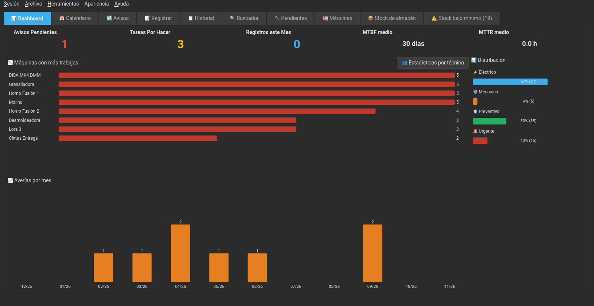
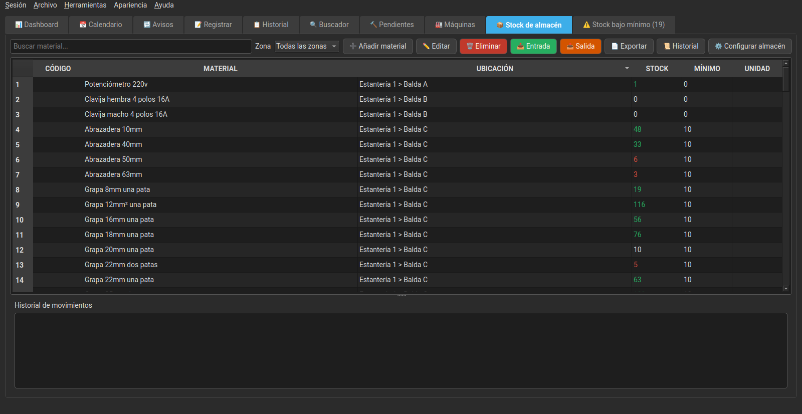
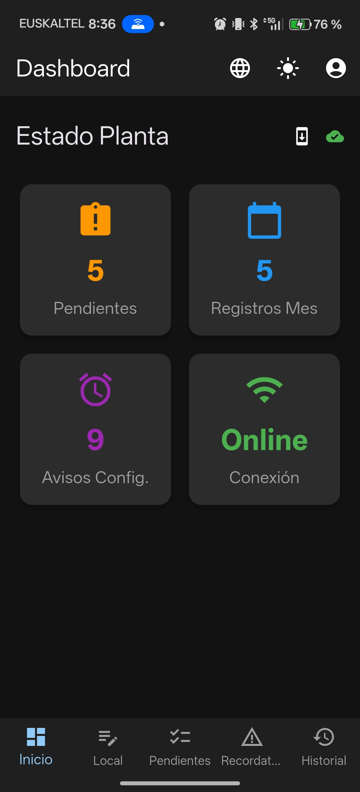
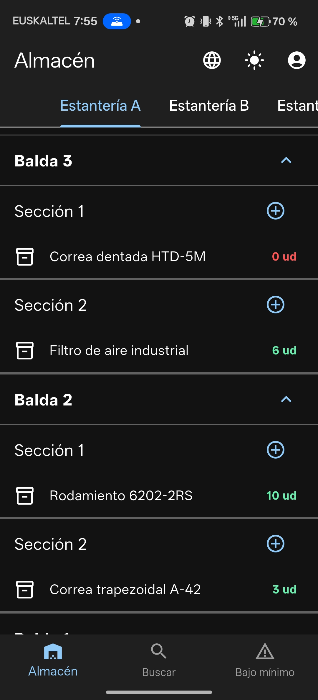
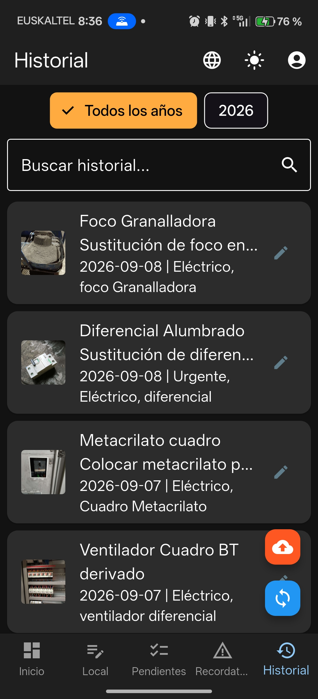

<p align="center">
  <a href="README.md"></a>
  <a href="README.es.md"></a>
  <a href="README.eu.md"></a>
  <a href="README.ca.md"></a>
  <a href="README.gl.md"></a>
  <a href="README.pt.md"></a>
  <a href="README.fr.md"></a>
</p>

# MantPro

<p align="center">
  
</p>

<p align="center">
  <strong>GMAO/CMMS libre et gratuite pour gérer la maintenance préventive et corrective de votre usine, atelier ou flotte, depuis le PC et Android.</strong>
</p>

<p align="center">
  
  
  
  
  
  
</p>

---

## 📋 Sommaire

- [Quel problème résout-elle ?](#-quel-problème-résout-elle-)
- [Pour qui ?](#-pour-qui-)
- [Pourquoi MantPro ?](#-pourquoi-mantpro-plutôt-quune-gmaocmms-commerciale-)
- [Vidéo de démonstration](#-vidéo-de-démonstration)
- [Captures d'écran](#-captures-décran)
- [Téléchargements](#-téléchargements)
- [Fonctionnalités](#-fonctionnalités)
- [Prérequis](#-prérequis)
- [Installation](#-installation)
- [Utilisation](#-utilisation)
- [Utilisateurs et accès](#-utilisateurs-et-accès)
- [Machines](#-machines)
- [Stock du magasin](#-stock-du-magasin)
- [Synchronisation PC-mobile](#-synchronisation-pc-mobile)
- [Sauvegardes](#-sauvegardes)
- [Contribuer](#-contribuer)
- [Feuille de route](#-feuille-de-route)
- [Licence](#-licence)
- [Contact](#-contact)

---

## 🧩 Quel problème résout-elle ?

Dans beaucoup d'ateliers et de petites et moyennes usines, la maintenance se
suit entre des papiers, un tableur Excel partagé et des messages WhatsApp. Ça
fonctionne, jusqu'au jour où quelqu'un a besoin de savoir **ce qui a été fait
sur une machine précise**, par qui, quand et avec quel matériel — et que cette
information est éparpillée à trois endroits différents (ou nulle part).

**MantPro centralise tout cela** : chaque technicien enregistre son
intervention depuis son mobile, sur le moment, avec des photos avant/après si
besoin, et tout est classé sur le PC par machine, par date et par personne,
prêt à être consulté ou exporté en rapport PDF.

## 🎯 Pour qui ?

Pensée pour celles et ceux qui assurent la maintenance au quotidien, pas pour
les services informatiques : techniciens de maintenance, responsables d'usine,
ateliers, PME industrielles et magasiniers qui ont besoin d'un vrai suivi des
machines, des interventions et du stock sans dépendre de tableurs dispersés.

## 🆚 Pourquoi MantPro plutôt qu'une GMAO/CMMS commerciale ?

- **Libre et gratuite** : code ouvert sous AGPL-3.0, sans limite de
  techniciens, de machines ni d'enregistrements
- **Auto-hébergé : gratuit pour toujours** : installé sur votre propre PC ou serveur, on ne paie ni par utilisateur ni par mois d'utilisation
- **Vos données, sur votre infrastructure** : la base de données reste sur
  votre propre PC ; vous ne dépendez pas d'un service cloud tiers qui existera
  peut-être encore l'an prochain
- **Vraiment hors ligne** : le mobile fonctionne sans connexion à internet ni
  au PC toute la journée, et se synchronise dès qu'il retrouve le réseau
- **Conçue depuis la maintenance elle-même** : les fonctions sont nées de
  besoins réels d'atelier (photos avant/après, lien avec la machine, stock de
  pièces, rappels récurrents...), pas d'une liste générique d'exigences de
  GMAO/CMMS

| | MantPro | GMAO/CMMS commerciale typique |
|---|---|---|
| **Prix** | Gratuit (auto-hébergé) | Abonnement mensuel par utilisateur |
| **Utilisateurs, machines et enregistrements** | Sans limite | Selon la formule choisie |
| **Où sont vos données** | Sur votre PC ou serveur | Dans le cloud de l'éditeur |
| **Application mobile hors ligne** | Toute la journée | Souvent limitée ou en consultation seule |
| **Magasin de pièces de rechange** | Inclus | Souvent en module séparé |
| **Code source** | Ouvert (AGPL-3.0) | Fermé |
| **Si l'éditeur disparaît** | Vous continuez à l'utiliser | Vous perdez le service |

*Comparaison avec le modèle habituel des GMAO/CMMS commerciales dans le cloud ; chaque produit est différent.*

## 🎬 Vidéo de démonstration

https://github.com/user-attachments/assets/11572710-e0ba-4f8b-b914-0a959006d4fb

## 📸 Captures d'écran

### Application de bureau

<p align="center">
  
  
</p>

### Application mobile

<p align="center">
  
  
  
</p>

---

## 📦 Téléchargements

Vous pouvez télécharger les versions précompilées depuis [GitHub Releases](https://github.com/AnabasaSoft/MantPro/releases) :

- **Windows** : exécutable `.exe` pour Windows
- **Linux** :
  - Binaire exécutable pour Linux
  - AppImage portable
  - Également disponible sur l'**AUR** (Arch User Repository)
  - Également disponible sur [**OBS**](https://build.opensuse.org/package/show/home:danitxu79/MantPro) (openSUSE Build Service) pour openSUSE Tumbleweed et Slowroll
- **Android** : fichiers `.apk` à installer directement
  - `MantPro.apk` : application des interventions de maintenance
  - `MantProStock.apk` : application de stock du magasin

Les versions marquées comme *pre-release* (`v3.10.2-dev`, `-rc.1`…) sont des
versions de test : elles ne sont proposées comme mise à jour qu'à ceux qui ont
déjà une version de test installée. Ceux qui utilisent une version stable ne
sont avertis que des versions stables. Les changements de chaque version sont
dans [CHANGELOG.md](CHANGELOG.md).

---

## ✨ Fonctionnalités

### 💻 Application de bureau (PC)

- **👥 Gestion des utilisateurs** : connexion par identifiant et mot de passe, rôles administrateur et technicien, création et désactivation d'utilisateurs et réinitialisation des mots de passe
- **✍️ Auteur des interventions** : chaque intervention enregistre qui l'a réalisée, visible dans l'historique et les rapports
- **🔒 Droits par enregistrement** : un technicien ne peut modifier ou supprimer que ses propres interventions ; un administrateur peut gérer n'importe laquelle, y compris réassigner l'auteur d'un ou plusieurs enregistrements à la fois
- **📋 Audit des modifications** : journal de qui modifie ou supprime chaque intervention (pas seulement de qui l'a créée), consultable et filtrable par technicien et par type d'action dans « Journal des modifications » (administrateurs uniquement)
- **🔐 Sessions des appareils** : liste les mobiles associés à chaque utilisateur, avec le modèle réel, et permet de révoquer une ou plusieurs sessions précises sans désactiver tout l'utilisateur (administrateurs uniquement). En se reconnectant depuis le même appareil, la session précédente est remplacée automatiquement au lieu de s'accumuler
- **📊 Tableau de bord avec KPI et graphiques** : cartes des rappels en attente, des tâches à faire, des enregistrements du mois et du MTBF/MTTR moyens de toute l'usine, ainsi que des graphiques des machines avec le plus de pannes et des pannes par mois, dessinés sans bibliothèque externe
- **🎨 Thèmes visuels** : choisissez entre mode sombre (par défaut), clair ou un style rétro inspiré de Windows 98, dans le menu « Apparence »
- **📅 Calendrier interactif** : visualisez et gérez les tâches de maintenance avec un code couleur (fériés, congés, jours avec tâches)
- **📝 Historique complet** : registre de toutes les interventions réalisées, avec photos avant/après et une **collection de photos** supplémentaire par intervention ; plusieurs enregistrements peuvent être supprimés à la fois
- **📄 Rapports PDF** : génération automatique de rapports professionnels avec logo personnalisable
- **📸 Gestion des images** : stockage et affichage des photos des interventions
- **📱 Synchronisation avec le mobile** : serveur intégré (démarrage automatique) pour se synchroniser avec l'application mobile via QR
- **🔍 Moteur de recherche** : recherche avancée par dates, tags et contenu
- **👤 Filtre par technicien** : filtrez l'historique et les exports (PDF, CSV et Excel) par la personne qui a réalisé l'intervention
- **📦 Sauvegarde et restauration** : sauvegarde manuelle complète (BD + photos) en choisissant où l'enregistrer, sauvegarde automatique incrémentale à la fermeture de l'application (voir [Sauvegardes](#-sauvegardes)) et restauration avec barre de progression, avec le sous-menu `Fichier > ♻️ Restaurer` pour choisir n'importe quelle sauvegarde manuelle ou aller directement aux sauvegardes automatiques
- **🏷️ Système de tags** : classement par étiquettes (Urgent, Électrique, Mécanique, Préventif)
- **🔨 Tâches en attente** : gestion des interventions en attente (créer, terminer, modifier, supprimer) et **assignation à un technicien précis**
- **🚦 Priorité des tâches en attente** : chaque intervention en attente a une priorité (Basse, Moyenne, Haute ou Critique) pour décider laquelle traiter en premier, avec sa couleur dans la liste ; on peut aussi joindre des photos à sa collection
- **↩️ Remettre en attente** : si une intervention a été terminée par erreur, elle peut revenir dans En attente d'un clic depuis l'historique (avec un avertissement si une machine y était associée, car cette information serait perdue), et cela est consigné dans l'audit
- **🔁 Rappels** : rappels de maintenance qui se répètent automatiquement. Si la date passe, ils ne sont pas sautés : ils restent **En attente** (orange) pendant la marge puis **En retard** (rouge) jusqu'à ce qu'ils soient faits, et la date suivante est calculée à partir du jour où l'intervention a réellement été faite
- **📦 Gestion du stock du magasin** : structure configurable de rayonnages, tablettes et sections, fiche article avec photo, entrées/sorties avec historique et alertes de stock sous le minimum
- **📄 Exporter le stock** : bouton « 📄 Exporter » dans l'onglet stock pour générer tout le magasin, une zone ou un rayonnage en PDF, CSV ou Excel, trié par emplacement ; l'onglet du stock sous le minimum a aussi son bouton pour n'exporter que les articles en alerte
- **🗑️ Durée maximale de conservation** : `Outils` permet de supprimer de l'historique les interventions plus anciennes qu'un nombre d'années, de mois ou de jours, avec leurs photos et une sauvegarde préalable (administrateurs uniquement)
- **📥 Importer depuis Excel/CSV** : `Fichier > Importer depuis Excel/CSV…` (administrateurs uniquement) importe machines, articles du magasin, rappels récurrents et utilisateurs depuis un modèle téléchargeable ou depuis votre propre Excel (une feuille ou le classeur entier en une fois), en associant les colonnes automatiquement, avec un aperçu ligne par ligne et une sauvegarde préalable. Les emplacements (zones, rayonnages, tablettes) et machines parentes inexistants sont créés automatiquement, et les utilisateurs reçoivent un mot de passe temporaire à changer à la première connexion
- **🏭 Suivi des machines** : arborescence de machines et sous-machines avec photo jointe, compteur d'interventions par année et par mois et association directe depuis chaque intervention enregistrée ou modifiée (voir [Machines](#-machines))
- **📊 Export** : vers PDF, CSV et Excel, avec filtre facultatif par technicien et indiquant la machine/sous-machine de chaque intervention, le cas échéant
- **📖 Aide intégrée** : `Aide > 📖 Instructions` ouvre un manuel complet par rubriques (premiers pas, utilisateurs, chaque onglet, menus, applications mobiles et problèmes fréquents), avec index et recherche, dans les 7 langues. Avec **F1**, il s'ouvre directement à la rubrique de l'onglet où vous êtes
- **👥 Statistiques par technicien** : bouton du tableau de bord affichant les interventions de chaque technicien par année et par mois, les pannes, les préventifs, les heures d'arrêt et les tâches en attente qui lui sont assignées en ce moment, avec un graphique en barres ; filtrable par type (toutes, interventions et pannes ou maintenance préventive) et exportable en PDF (avec logo) et Excel
- **🔩 Pièces de rechange par machine** : quels articles du magasin chaque machine porte et en quelle quantité, avec leur stock et leur emplacement, et dans quelles machines chaque article est utilisé (voir [Machines](#-machines))
- **🏷️ Étiquettes QR par machine** : PDF d'étiquettes à coller sur les machines ; en les scannant avec l'application MantPro, la fiche de la machine s'ouvre
- **🔍 Alerte de doublons** : lors de la création ou du renommage d'une machine, ou de la création ou modification d'un article, avertit s'il en existe déjà un autre avec le même code ou un nom identique ou très similaire (par exemple « Extracteur de fines » / « Extraction de fines »), sans avertir quand seul le numéro change (« Lora 1 » / « Lora 2 »)
- **📲 Installer les applications avec un QR code** : `Outils > 📱 Installer MantPro sur le mobile` et `📦 Installer MantPro Stock sur le mobile` affichent un QR code qui, scanné avec l'appareil photo du mobile, télécharge la dernière version stable de l'application
- **🔔 Avis de mise à jour** : `Aide > 🔄 Rechercher des mises à jour` signale les nouvelles versions ; la version installée depuis OBS (openSUSE) indique qu'elle se met à jour avec `zypper`

### 📱 Application mobile (Android)

- **🔐 Connexion par utilisateur** : chaque technicien se connecte une fois et la session reste enregistrée sur l'appareil
- **📝 Saisie rapide** : enregistrement des interventions sur le terrain, signées automatiquement avec votre utilisateur
- **📷 Appareil photo intégré** : prenez des photos et annotez-les
- **🖼️ Collection de photos** : en plus des photos avant et après, ajoutez à une intervention ou à une tâche en attente autant de photos que vous voulez (appareil photo ou galerie) ; en touchant une photo, elle s'affiche en plein écran, en passant de l'une à l'autre et en zoomant à deux doigts
- **✏️ Éditeur d'images** : dessinez sur les photos pour marquer les zones importantes
- **🔄 Synchronisation automatique** : envoi automatique des données au PC via QR code
- **💾 Stockage local** : conserve les enregistrements hors ligne jusqu'à la synchronisation
- **📋 Interventions en attente** : consultez et gérez les tâches assignées depuis le PC, avec le filtre **« Seulement les miens »**
- **🔄 Actualisation à l'ouverture** : au démarrage, l'application synchronise en arrière-plan les données de tous les onglets
- **🔁 Synchroniser manuellement** : les onglets En attente, Historique et Rappels ont leur propre bouton pour renvoyer immédiatement ce que le mobile a et que le PC n'a pas encore
- **↩️ Remettre en attente** : par un appui long sur un enregistrement de l'Historique, il peut revenir dans l'onglet En attente s'il a été terminé par erreur
- **🏷️ Tags rapides** : système d'étiquettes rapide avec cases à cocher
- **🔌 Mode hors ligne** : travaillez sans connexion et synchronisez quand vous pouvez
- **⏰ Rappels quotidiens** : notification automatique à 8 h 00 (heure locale) s'il reste des interventions en attente non terminées
- **🧰 Articles utilisés** : ajoutez à l'intervention les articles du magasin que vous avez utilisés, en les recherchant par nom ou code ; ils sont déduits du stock automatiquement à l'enregistrement (voir [Articles utilisés dans une intervention](#-stock-du-magasin))
- **🏭 Associer une machine** : choisissez dans une liste la machine ou sous-machine sur laquelle l'intervention a été faite, aussi bien en créant un enregistrement qu'en modifiant un enregistrement déjà synchronisé de l'historique
- **🔄 Connectée en arrière-plan** : tant que l'application est ouverte, même en arrière-plan, elle continue de se synchroniser avec le PC et affiche une notification (« Connecté au PC » / « Pas de connexion avec le PC ») avec un bouton « Fermer ». Une fois complètement fermée, elle ne consomme plus de batterie
- **📶 Première synchronisation avec progression** : barre de progression pendant le téléchargement des données et des photos, téléchargées en parallèle pour aller plus vite
- **🏷️ Scanner la machine** : le bouton de scan lit l'étiquette QR d'une machine et ouvre sa fiche, sans connexion : son emplacement, ses dernières interventions, ses **pièces de rechange** avec le stock du magasin, et un bouton pour enregistrer une intervention déjà liée à elle
- **⬆️ Mise à jour depuis l'application** : quand une nouvelle version existe, l'avis propose les boutons « Plus tard » et « Mettre à jour » ; « Mettre à jour » télécharge l'APK avec une barre de progression et ouvre l'installateur d'Android, sans passer par GitHub

### 📦 Application mobile de stock (Android)

Application indépendante (`mantpro_stock_app`), conçue pour consulter et
mouvementer le stock du magasin depuis le mobile sans avoir besoin de
l'application des interventions.

- **🔐 Connexion par utilisateur** : utilise le même système d'utilisateurs et de session que l'application des interventions
- **🗂️ Navigation dans le magasin** : arborescence rayonnages > tablettes > sections, comme sur le PC
- **🔎 Recherche d'articles** : par nom, code, description ou emplacement
- **➕➖ Entrées et sorties** : enregistrez des mouvements de stock depuis le mobile, avec un motif facultatif
- **🔀 Transferts** : déplacer un article d'une section à une autre est consigné dans son historique de mouvements
- **🎨 Alerte visuelle de stock** : quantité en rouge sous le minimum, en vert au-dessus et dans la couleur normale si elle est exactement égale
- **⚠️ Stock sous le minimum** : onglet dédié aux articles en alerte
- **🔄 Actualisation automatique** : l'écran se met à jour tout seul lorsqu'il détecte des modifications, faites sur le mobile comme sur le PC
- **🔌 Mode hors ligne** : sans connexion au PC, l'application n'attend pas : elle consulte les données enregistrées et permet d'enregistrer immédiatement créations, modifications, entrées et sorties, qui sont envoyées toutes seules au PC dès qu'il est de nouveau joignable
- **🔔 Rappel quotidien de contrôle du stock** : notification automatique à 8 h 00 (heure locale) invitant à vérifier la quantité réelle de 5 articles du magasin, choisis au hasard et différents chaque jour ; en la touchant, un écran s'ouvre pour corriger la quantité de chacun sans avoir à les chercher. S'il n'y a aucun article enregistré, aucune notification n'est affichée
- **🔄 Connectée en arrière-plan** : comme MantPro, elle continue de se synchroniser en arrière-plan, avec sa notification ; l'icône utilisateur devient **verte** s'il y a une connexion avec le PC et **rouge** sinon
- **🔩 Utilisé dans** : chaque article indique dans quelles machines il sert de pièce de rechange et combien chacune en porte, même sans connexion
- **🔍 Alerte de doublons** : lors de la création ou de la modification d'un article, avertit s'il en existe déjà un autre avec le même code ou un nom très similaire, en comparant avec les articles enregistrés sur le mobile (fonctionne sans connexion)
- **⬆️ Mise à jour depuis l'application** : comme MantPro, elle télécharge et installe la nouvelle version depuis l'avis lui-même

---

## 🔧 Prérequis

### Application de bureau

- **Python** : 3.8 ou supérieur
- **Système d'exploitation** : Windows ou Linux
- **Dépendances Python** :
  - PyQt6
  - Flask
  - ReportLab
  - qrcode
  - requests
  - xlsxwriter
  - openpyxl
  - sqlite3 (inclus avec Python)

### Application mobile

Valable aussi bien pour `mantenimiento_app` (interventions) que pour `mantpro_stock_app` (stock) :

- **Flutter** : 3.0 ou supérieur
- **Dart SDK** : 2.17 ou supérieur
- **Android** : API Level 21+ (Android 5.0+)

---

## 📥 Installation

### Application de bureau

#### Option 1 : téléchargement précompilé (recommandé)

Téléchargez la version correspondant à votre système depuis [GitHub Releases](https://github.com/AnabasaSoft/MantPro/releases) :

- **Windows** : téléchargez et lancez le `.exe`
- **Linux** :
  - Téléchargez le binaire exécutable et rendez-le exécutable : `chmod +x mantpro`
  - Ou utilisez l'**AppImage** (sans installation) : `chmod +x MantPro.AppImage && ./MantPro.AppImage`
  - Les paquets **`.deb`** et **`.rpm`** sont signés numériquement avec GPG (voir [Vérifier la signature des paquets](#-vérifier-la-signature-des-paquets-linux))
  - **Arch Linux** : disponible sur l'AUR : `yay -S mantpro` ou `paru -S mantpro`
  - **openSUSE Tumbleweed / Slowroll** : disponible sur [OBS](https://build.opensuse.org/package/show/home:danitxu79/MantPro), compilé avec le Python et le PyQt6 de la distribution et mis à jour avec `zypper` :
    ```bash
    sudo zypper ar -f https://download.opensuse.org/repositories/home:/danitxu79/openSUSE_Tumbleweed/home:danitxu79.repo
    sudo zypper in mantpro
    ```
    (pour Slowroll, remplacez `openSUSE_Tumbleweed` par `openSUSE_Slowroll` dans l'URL)

#### 🔏 Vérifier la signature des paquets (Linux)

Les paquets `.deb` et `.rpm` publiés dans chaque release sont signés avec la clé GPG officielle d'AnabasaSoft. Pour les vérifier avant de les installer :

**Empreinte de la clé** (vérifiez-la aussi sur [anabasasoft.github.io](https://anabasasoft.github.io/about.html#firma)) : `11C7 C6C8 127D FE48 33DE  30EF 9D7A AEC8 1842 C199` (RSA 4096, expire le 2028-10-06). Si celle qu'affiche `gpg` ne correspond pas exactement, n'installez pas le paquet.

1. Téléchargez la clé publique du dépôt ([`firma/anabasasoft_public.asc`](firma/anabasasoft_public.asc)) dans un fichier (**n'utilisez pas `curl | rpm --import -`** : certaines versions de `rpm` n'acceptent pas de lire la clé depuis l'entrée standard et échouent) :
   ```bash
   curl -sL https://raw.githubusercontent.com/AnabasaSoft/MantPro/main/firma/anabasasoft_public.asc -o /tmp/anabasasoft_public.asc
   ```

2. Importez la clé (une seule fois par ordinateur) :
   ```bash
   # Fedora, openSUSE, RHEL... (paquet .rpm)
   sudo rpm --import /tmp/anabasasoft_public.asc

   # Debian, Ubuntu... (paquet .deb, nécessite dpkg-sig)
   gpg --import /tmp/anabasasoft_public.asc
   ```

3. Vérifiez que la clé a bien été importée :
   ```bash
   # RPM
   rpm -qa 'gpg-pubkey*' --qf '%{name}-%{version}-%{release} --> %{summary}\n' | grep -i anabasasoft

   # DEB (ou toute distribution avec gpg) : affiche aussi l'empreinte
   gpg --fingerprint AnabasaSoft
   ```

4. Vérifiez la signature du paquet téléchargé :
   ```bash
   # RPM
   rpm --checksig mantpro-*.rpm

   # DEB
   dpkg-sig --verify mantpro_*.deb
   ```
   Une signature correcte affiche `OK` sur la ligne de la signature (au lieu de `NOKEY` ou `MISSING KEYS`).

Une signature valide confirme que le paquet provient d'AnabasaSoft et qu'il n'a pas été modifié.

#### Option 2 : installation depuis le code source

1. **Cloner le dépôt** :
   ```bash
   git clone https://github.com/AnabasaSoft/MantPro.git
   cd MantPro
   ```

2. **Créer un environnement virtuel** (recommandé) :
   ```bash
   python -m venv venv
   source venv/bin/activate  # Sous Windows : venv\Scripts\activate
   ```

3. **Installer les dépendances** :
   ```bash
   pip install -r requirements.txt
   ```

4. **Lancer l'application** :
   ```bash
   python main.py
   ```

### Application mobile

#### Option 1 : téléchargement direct (recommandé)

Téléchargez le `.apk` correspondant depuis [GitHub Releases](https://github.com/AnabasaSoft/MantPro/releases) et installez-le sur votre appareil Android : `MantPro.apk` pour les interventions, `MantProStock.apk` pour le stock du magasin. Ce sont des applications indépendantes : vous pouvez installer l'une, l'autre ou les deux.

**Remarque** : il peut être nécessaire d'activer « Sources inconnues » dans les paramètres de sécurité de l'appareil.

**Depuis le PC, avec un QR code** : `Outils > 📱 Installer MantPro sur le
mobile` (ou `📦 Installer MantPro Stock sur le mobile`) affiche un QR code.
Scannez-le avec l'appareil photo du mobile, ouvrez le lien et la dernière
version stable de l'application est téléchargée. Une fois installées, les
applications signalent les nouvelles versions et se mettent à jour depuis l'avis
lui-même avec le bouton « Mettre à jour ».

#### Option 2 : compiler depuis le code source

1. **Aller dans le dossier de l'application** (`mantenimiento_app` pour les interventions, `mantpro_stock_app` pour le stock) :
   ```bash
   cd mantenimiento_app
   ```

2. **Installer les dépendances** :
   ```bash
   flutter pub get
   ```

3. **Lancer sur un appareil ou un émulateur** :
   ```bash
   flutter run
   ```

4. **Compiler l'APK (Android)** :
   ```bash
   flutter build apk --release
   ```

---

## 🚀 Utilisation

### Première configuration

#### Application de bureau

1. **Lancer l'application** : exécutez `python main.py` (le serveur de synchronisation démarre tout seul, inutile de le lancer à la main)
2. **Première connexion** : au premier lancement, l'utilisateur `admin` est créé avec le mot de passe `admin`. L'application **oblige à le changer** à la connexion
3. **Créer les utilisateurs** : menu `Outils` > `👥 Gestion des utilisateurs` > ajoutez chaque technicien
4. **Configurer le logo** (facultatif) : menu `Fichier` > `📤 Exporter` > `📄 Options PDF` > `🖼️ Ajouter / Changer le logo`
5. **Enregistrer une intervention** : onglet « 📝 Enregistrer » > remplissez le résumé et les détails > « 💾 ENREGISTRER »
6. **Créer une tâche en attente** : onglet « 🔨 En attente » > groupe « Nouvelle intervention » (Titre + Détails + « Assigner à ») > « Ajouter »

#### Application mobile

1. **Installer l'application** sur votre mobile
2. **Se connecter au PC** :
   - Vérifiez que le PC et le mobile sont sur le même réseau Wi-Fi
   - Sur le PC : menu `Outils` > `📲 Synchroniser l'app (QR)`
   - Sur le mobile : touchez « Associer le PC » et scannez le code
3. **Se connecter** : saisissez l'utilisateur et le mot de passe que l'administrateur vous a créés. La session reste enregistrée : il suffit de le faire une fois
4. **C'est prêt** : vous pouvez désormais enregistrer des interventions depuis le mobile

### Flux de travail type

#### Depuis le PC

1. **Créer et assigner une tâche en attente** :
   - Onglet « 🔨 En attente » > groupe « Nouvelle intervention » > remplissez le Titre et les Détails, choisissez le technicien dans « Assigner à » > « Ajouter »
   - Gérez-la avec les boutons « ✅ Terminer », « ✏️ Modifier », « ❌ Supprimer » ou « 👤 Réassigner »
   - La liste « Voir ceux de » filtre par technicien (inclut « Non assigné »)

2. **Vérifier les interventions terminées** :
   - Les interventions synchronisées depuis le mobile apparaissent automatiquement
   - Consultez les photos (avant/après et collection) et les détails dans l'onglet « 📋 Historique » ou dans le « 📅 Calendrier »
   - La colonne « Réalisé par » indique qui a fait chaque intervention, et la liste au-dessus permet de n'afficher que celles d'une personne

3. **Générer des rapports** :
   - Menu `Fichier` > `📤 Exporter` > `📄 Options PDF` > `📄 Générer le PDF maintenant`
   - Dans la fenêtre, vous pouvez choisir le technicien, et son nom apparaît dans le titre du rapport
   - Ou exportez en `📄 CSV` / `📊 Excel` depuis `Fichier` > `📤 Exporter`

#### Depuis le mobile

1. **Associer au PC et se connecter** (seulement la première fois, ou en cas de changement de réseau) :
   - Touchez « Associer le PC » et scannez le QR affiché par le PC
   - Saisissez votre utilisateur et votre mot de passe
   - Le mobile mémorise l'adresse du PC et votre session pour se synchroniser automatiquement ensuite

2. **Enregistrer une intervention** :
   - Touchez « Nouveau » ou sélectionnez une intervention en attente déjà synchronisée depuis le PC
   - Avec le filtre « Seulement les miens », vous ne voyez que celles qui vous sont assignées
   - Remplissez le titre et les détails
   - Prenez la photo « avant » et, si vous voulez, la photo « après » avec l'appareil photo ; si besoin, ajoutez-en d'autres à la collection
   - Dessinez ou annotez la photo si nécessaire
   - Sélectionnez les tags adaptés
   - Enregistrez

3. **Synchroniser** :
   - À l'ouverture de l'application, tout se synchronise en arrière-plan (un indicateur apparaît dans la barre du haut)
   - Vous pouvez aussi forcer la synchronisation en tirant la liste vers le bas ou avec l'icône de synchronisation
   - Les enregistrements sont envoyés au PC et retirés du mobile une fois l'envoi confirmé
   - Tout fonctionne sans connexion : ce qui est en attente reste enregistré et part dès qu'il y a du réseau

---

## 👥 Utilisateurs et accès

### Rôles

Un même utilisateur peut avoir **un ou plusieurs rôles à la fois** (par
exemple technicien et magasin). Rôles disponibles :

| Rôle | Ce qu'il peut faire |
|------|---------------------|
| **Administrateur** | Tout ce que font le technicien et le magasin, plus créer et désactiver des utilisateurs, changer les rôles, réinitialiser les mots de passe, modifier ou supprimer **n'importe quel** enregistrement de l'historique, réassigner l'auteur d'un ou plusieurs enregistrements à la fois et consulter le journal d'audit des modifications |
| **Technicien** | Enregistrer des interventions, terminer les tâches en attente et les rappels, modifier ou supprimer **uniquement ses propres** enregistrements de l'historique et changer son propre mot de passe |
| **Magasin** | Créer ou modifier des articles et enregistrer des entrées/sorties de stock depuis l'application **MantPro Stock** |

Il doit toujours y avoir **au moins un administrateur actif** : l'application
empêche de retirer le rôle ou de désactiver le dernier qui reste.

> Dans l'application de bureau, n'importe quel utilisateur (quel que soit son
> rôle) peut enregistrer des mouvements de stock ; le rôle **Magasin** est ce
> qui autorise cette même gestion (créations, modifications et mouvements)
> depuis le mobile.

### Gestion depuis le PC

- **Création** : `Outils` > `👥 Gestion des utilisateurs` > remplissez
  identifiant, nom, mot de passe et rôle > « ➕ Ajouter ». Si vous laissez
  cochée « Exiger le changement à la connexion », la personne devra définir
  son propre mot de passe à la première connexion.
- **Désactivation** : elle est **logique** (l'utilisateur devient inactif). Il
  n'est jamais supprimé, afin de ne pas perdre l'auteur des interventions
  qu'il a déjà réalisées.
- **Réinitialiser le mot de passe** : utile quand quelqu'un l'oublie. En le
  changeant, toutes les sessions mobiles ouvertes de cette personne sont
  fermées automatiquement.
- **Changer son propre mot de passe** : `Outils` > `🔑 Changer mon mot de passe`.

### Sessions des appareils

`Outils` > `🔐 Sessions des appareils` (administrateurs uniquement) liste
toutes les sessions mobiles ouvertes de tous les utilisateurs, avec le modèle
de l'appareil, sa date d'ouverture, sa date d'expiration et si elle est
toujours active ou déjà expirée. On peut sélectionner une ou plusieurs lignes
et les révoquer, ce qui ferme la session de ce mobile sans devoir désactiver
tout l'utilisateur (ce qui fermerait *tous* ses appareils d'un coup).

Si un utilisateur se reconnecte depuis un appareil où il avait déjà une
session ouverte (même fabricant et même modèle), l'ancienne session de cet
appareil est supprimée automatiquement lors de la création de la nouvelle, au
lieu de s'accumuler dans la liste.

La colonne **Connexion** indique si chaque mobile est **en ligne** en ce moment
et quand a eu lieu son dernier contact. Les applications se signalent au PC
toutes les quelques secondes tant qu'elles sont ouvertes (y compris en
arrière-plan), et préviennent qu'elles se déconnectent une fois complètement
fermées : l'état se met donc à jour immédiatement.

### Auteur des interventions

Chaque enregistrement conserve le technicien qui l'a réalisé, qu'il ait été
créé sur le PC ou envoyé depuis le mobile. Les enregistrements antérieurs à la
mise en place du système d'utilisateurs sont marqués **`Histórico`**.

Sur le mobile, l'attribution est toujours décidée **par le serveur** à partir
du jeton de session, jamais d'après une donnée envoyée par l'application. Un
appareil ne peut pas signer des interventions au nom d'une autre personne.

Depuis le PC, un technicien ne peut modifier ou supprimer que ses propres
enregistrements de l'historique ; un administrateur peut le faire avec
n'importe lequel. En faisant un clic droit sur une ou plusieurs lignes de
l'historique (sélection multiple avec Ctrl/Maj), un administrateur peut aussi
**réassigner l'auteur** en bloc, et chaque changement est consigné dans le
journal d'audit.

### Journal des modifications (audit)

Chaque fois qu'une intervention est modifiée ou supprimée, on enregistre qui
l'a fait, quand et ce qui a changé. Les administrateurs peuvent le consulter
dans `Outils` > `📋 Journal des modifications`, avec des filtres par
technicien et par type d'action (modifier/supprimer).

### Session sur le mobile

Le technicien se connecte une fois et le jeton reste enregistré sur
l'appareil. La session se ferme toute seule si l'administrateur désactive
l'utilisateur ou réinitialise son mot de passe ; dans ce cas, l'application
revient à l'écran de connexion **sans perdre les enregistrements encore en
attente d'envoi**.

---

## 🏭 Machines

> Gestion disponible dans l'application de bureau, avec l'association à la
> machine également sélectionnable depuis le mobile lors de l'enregistrement
> ou de la modification d'une intervention.

Onglet « 🏭 Machines » du PC, conçu pour suivre les pannes et les
interventions de chaque équipement dans le temps.

- **🌳 Arborescence de machines** : les machines peuvent avoir des
  sous-machines (par exemple, une ligne avec plusieurs équipements), formant
  une hiérarchie aussi profonde que nécessaire
- **📅 Interventions classées par année et par mois** : en dépliant une
  machine apparaissent les années avec interventions et, en dépliant une
  année, les mois ; chaque niveau affiche un compteur du nombre
  d'interventions, avec un chargement à la demande pour ne pas ralentir
  l'arborescence
- **🖱️ Accès direct à l'intervention** : un double-clic sur une intervention
  de l'arborescence ouvre directement sa fiche de modification
- **📸 Photo de la machine** : chaque machine ou sous-machine peut avoir une
  photo jointe, visible dans un cadre à côté de l'arborescence en la
  sélectionnant
- **🔗 Association depuis chaque intervention** : en enregistrant une nouvelle
  intervention (PC ou mobile) ou en modifiant une intervention existante, on
  peut choisir à quelle machine/sous-machine elle appartient
- **📊 Dans les exports** : la machine ou sous-machine associée apparaît comme
  colonne supplémentaire dans les exports PDF, CSV et Excel
- **🗺️ Zone héritée** : une nouvelle sous-machine prend par défaut la zone de
  sa machine parente
- **🔩 Pièces de rechange de chaque machine** : sous l'arborescence s'affichent
  les articles du magasin montés sur la machine sélectionnée, combien elle en
  porte, leur stock (en rouge sous le minimum), leur emplacement et une note
  (par exemple « côté moteur »). On les ajoute avec « ➕ Ajouter une pièce »,
  on les exporte en PDF ou Excel, et un double-clic ouvre l'article dans le
  magasin
- **🏷️ Étiquettes QR** : le bouton « 🏷️ Étiquettes QR » génère un PDF de
  feuilles A4 avec 24 étiquettes de 70 × 37 mm (de la machine sélectionnée,
  avec ses sous-machines, ou de toutes). En les scannant avec l'application
  MantPro, la fiche de la machine s'ouvre
- **🔍 Noms similaires** : lors de la création ou du renommage d'une machine,
  avertit s'il en existe déjà une autre au même niveau avec un nom identique
  ou très similaire

---

## 📦 Stock du magasin

> Gestion complète depuis l'application de bureau, avec consultation et
> mouvements également disponibles depuis le mobile (`mantpro_stock_app`).
> Elle utilise sa propre base de données (`almacen.db`), indépendante de
> celle des interventions de maintenance.

### Structure du magasin

Le magasin est organisé en trois niveaux, inspirés des conventions
habituelles d'adressage des magasins :

```
Rayonnage → Tablette → Section
```

- En créant un rayonnage, on définit le **nombre de tablettes**, le **nombre
  de sections par tablette** (0 = sans sections prédéfinies, qu'on peut
  ajouter ensuite) et s'il possède un **espace au sol** sous la tablette
  inférieure, traité comme une tablette spéciale (« Sol »)
- Les tablettes sont numérotées de bas en haut à partir de 1, pour pouvoir en
  ajouter de nouvelles sans renuméroter les existantes
- On ne peut pas supprimer un rayonnage, une tablette ou une section tant
  qu'ils contiennent des articles

La structure se gère avec le bouton **« ⚙️ Configurer le magasin »** de
l'onglet « 📦 Stock du magasin », visible **uniquement pour les
administrateurs**.

### Articles

- Création et modification avec code (facultatif), nom, description, unité,
  stock minimum, emplacement (rayonnage / tablette / section) et **photo
  jointe**
- Recherche par **nom, code, description ou emplacement**
- Le stock est mis en évidence en **rouge** sous le minimum, en **vert**
  au-dessus et dans la couleur normale s'il est exactement égal au minimum,
  aussi bien sur le PC que sur le mobile
- En sélectionnant plusieurs articles à la fois (Ctrl/Maj + clic droit) sur
  le PC, on peut **les changer d'emplacement** ou **les supprimer** en bloc
- Chaque article indique **dans quelles machines il est utilisé** comme pièce
  de rechange, et on peut lui associer des machines directement en le créant
  ou en le modifiant, avec la quantité que porte chacune
- Lors de la création ou de la modification d'un article, une alerte s'affiche
  s'il en existe déjà un autre avec le **même code ou un nom très similaire**,
  pour ne pas le créer deux fois

### Entrées, sorties et transferts

- **N'importe quel utilisateur** peut enregistrer des entrées et des sorties
  de stock ; seule la configuration de la structure du magasin est réservée
  aux administrateurs
- Chaque mouvement est enregistré avec la date, la quantité, l'utilisateur et
  un motif facultatif, visible dans l'historique de chaque article
- Les sorties enregistrées manuellement (PC ou `mantpro_stock_app`) ne peuvent
  pas rendre le stock négatif
- Changer un article d'emplacement est aussi consigné dans son historique,
  comme un mouvement de type **transfert** (de quelle section vers quelle
  section)
- Le bouton **« 📜 Historique »** affiche tous les mouvements du magasin à la
  suite (entrées, sorties et transferts), avec le nom de chaque article et des
  filtres par texte et par type

### Articles utilisés dans une intervention (MantPro)

En terminant une intervention depuis l'application **MantPro** (mobile), on
peut ajouter les articles utilisés, en les recherchant par nom ou code et en
indiquant la quantité. À l'enregistrement de l'intervention, ces articles sont
automatiquement déduits du magasin, avec le motif « Utilisé pour
l'intervention : ... » pour assurer la traçabilité.

Contrairement aux sorties manuelles, **cette déduction peut rendre le stock
négatif** : l'article a déjà été physiquement utilisé, même s'il n'y avait pas
assez de stock enregistré, donc bloquer le mouvement n'aurait pas de sens. Le
stock négatif apparaît aussi bien sur le PC que dans `mantpro_stock_app` et
sert d'avertissement : il faut vérifier et réapprovisionner cet article au
plus vite.

### Alertes de stock sous le minimum

L'onglet **« ⚠️ Stock sous le minimum »** affiche, dans une vue séparée, les
articles en rupture ou sous le minimum défini. Le titre de l'onglet indique
lui-même combien d'articles sont en alerte, et de là on peut aller
directement à l'article dans « Stock du magasin », enregistrer une entrée sans
changer d'onglet ou exporter la liste avec le bouton « 📄 Exporter ».

### Exporter le stock

Dans l'onglet **« 📦 Stock du magasin »** du PC, le bouton **« 📄 Exporter »**
ouvre une fenêtre pour choisir le **format** (PDF, CSV ou Excel) et **quoi
exporter** : tout le magasin, une zone ou un seul rayonnage. La liste est
triée par emplacement, pour parcourir le magasin avec elle en main ; le PDF et
l'Excel indiquent aussi la date, le nombre d'articles et combien sont sous le
minimum (en rouge). Le tableau de stock lui-même s'affiche aussi trié par
emplacement par défaut (Rayonnage 1, 2… 10).

---

## 🔄 Synchronisation PC-mobile

### Fonctionnement

MantPro utilise un système de synchronisation basé sur :

1. **Un serveur Flask** intégré à l'application de bureau
2. **Des QR codes** pour une connexion rapide et sûre
3. **Une API REST authentifiée par jeton** : tous les endpoints de données
   exigent une session valide ; si le jeton n'est plus valide, le serveur
   répond `401` et le mobile revient à l'écran de connexion
4. **Le Wi-Fi local**, sans besoin d'internet
5. **Une synchronisation complète à l'ouverture de l'application**, en
   arrière-plan et sans bloquer l'interface
6. Tant que les applications mobiles sont ouvertes, même en arrière-plan,
   elles continuent de se synchroniser et le PC les voit **en ligne** dans
   `Outils > 🔐 Sessions des appareils`
7. La première synchronisation affiche une **barre de progression** et
   télécharge les données en parallèle et les photos 4 par 4

> 🔒 La synchronisation est **chiffrée (HTTPS)**. Le PC crée son propre
> certificat et son empreinte voyage dans le QR code : le mobile ne se connecte
> qu'à *ce* PC, donc personne sur le Wi-Fi ne peut lire le trafic ni se faire
> passer pour lui. Les mobiles déjà associés passent tout seuls en HTTPS en
> mettant l'application à jour.

### Configuration réseau

Pour que la synchronisation fonctionne :

- ✅ Le PC et le mobile doivent être sur le **même réseau Wi-Fi**
- ✅ Le **pare-feu** doit autoriser les connexions sur le port 5000 (ou celui
  configuré)
- ✅ Sous Windows, il peut être nécessaire de créer une exception dans le
  pare-feu

### Dépannage

**Le mobile ne se connecte pas au PC :**
- Vérifiez que les deux appareils sont sur le même réseau
- Vérifiez que le serveur est actif sur le PC (icône verte)
- Essayez de désactiver temporairement le pare-feu du PC
- Générez de nouveau le QR code et scannez-le à nouveau

**Je ne peux pas me connecter depuis le mobile :**
- Vérifiez que MantPro est ouvert sur le PC : c'est lui qui valide la connexion
- Confirmez l'utilisateur et le mot de passe avec l'administrateur ; il peut le réinitialiser
- Si le PC a changé d'IP, scannez de nouveau le QR depuis l'écran de connexion lui-même (« Associer un autre PC »)

**L'application m'a renvoyé à l'écran de connexion :**
- C'est normal si l'administrateur a réinitialisé votre mot de passe ou désactivé votre utilisateur
- Vos enregistrements non envoyés **ne sont pas perdus** : reconnectez-vous et ils seront synchronisés

**J'ai oublié le mot de passe administrateur :**
- Un autre administrateur peut le réinitialiser dans `Outils` > `👥 Gestion des utilisateurs`
- S'il n'y a aucun autre administrateur, il faut le réinitialiser directement
  dans la table `usuarios` de la base de données

**Les photos ne se synchronisent pas :**
- Vérifiez qu'il y a assez d'espace disque sur le PC
- Vérifiez les droits du dossier `fotos_recibidas`
- Vérifiez que la photo a bien été enregistrée sur le mobile

**Je ne reçois pas la notification quotidienne des rappels en attente (Android) :**
- Vérifiez que l'autorisation des notifications est accordée : `Paramètres → Applications → MantPro → Notifications`
- Chez des fabricants comme **OPPO/Realme (ColorOS), Xiaomi (MIUI) ou Huawei**, le système peut supprimer l'alarme programmée même avec l'autorisation accordée. Il faut en plus :
  - `Paramètres → Batterie → Utilisation de la batterie par application → MantPro` → choisir **« Aucune restriction »**
  - `Paramètres → Batterie → Démarrage automatique` → **activer** MantPro
- La notification est réévaluée à chaque ouverture du Tableau de bord ; si vous venez de marquer une intervention comme terminée, rouvrez-le pour qu'elle soit annulée ou reprogrammée correctement.

**Je ne reçois pas la notification quotidienne de contrôle du stock (MantPro Stock) :**
- Les mêmes vérifications que pour MantPro s'appliquent (autorisation des notifications et exclusion de l'optimisation de la batterie, voir ci-dessus)
- Si le magasin n'a aucun article enregistré, aucune notification n'est affichée : c'est le comportement attendu
- Elle est réévaluée à chaque synchronisation de l'application avec le PC (à l'ouverture et toutes les 25 secondes tant qu'elle est ouverte)

### 🔒 Remarque sur la sécurité

La synchronisation est chiffrée en HTTPS et le certificat du PC est épinglé
par l'empreinte du QR code. Pendant la transition, le PC continue aussi de
répondre en HTTP sur le port configuré pour les applications des versions
précédentes ; HTTPS utilise le **port suivant** (par exemple 5000 et 5001),
donc s'il y a un pare-feu il faut ouvrir les deux. Si vous exposez un jour le
serveur hors du réseau local, faites-le via un VPN.

Les bases de données peuvent aussi être enregistrées **chiffrées** (`Outils >
Chiffrement des bases de données…`, SQLCipher) : la clé est conservée dans le
trousseau du système et une clé de récupération s'affiche pour être notée.
C'est désactivé par défaut et indisponible dans le paquet openSUSE.

---

## 💾 Sauvegardes

MantPro fait une **sauvegarde automatique à la fermeture** (les bases de
données, et les photos dans des ZIP incrémentaux par année) et permet de faire
une **sauvegarde complète manuelle** depuis `Fichier > Sauvegarde` et de la
restaurer depuis `Fichier > Restaurer`. `Outils` permet aussi de supprimer les
photos qu'aucun enregistrement n'utilise plus et d'effacer les interventions
plus anciennes qu'une durée donnée, toujours avec une sauvegarde préalable.

🔒 Avec `Fichier > Mot de passe des sauvegardes…`, les sauvegardes sont
**chiffrées** (AES-256 avec une clé dérivée du mot de passe) : une sauvegarde
qui quitte l'ordinateur (clé USB, NAS, cloud) ne peut pas être ouverte sans
lui. Si vous oubliez le mot de passe, les sauvegardes chiffrées sont
irrécupérables.

Détails complets : [docs/backups.md](docs/backups.md) (en anglais) ·
[docs/copias-de-seguridad.md](docs/copias-de-seguridad.md) (en espagnol).

---

## 🤝 Contribuer

Les contributions sont les bienvenues ! Avant d'ouvrir une *pull request*,
lisez [CONTRIBUTING.md](CONTRIBUTING.md) : il explique comment préparer vos
modifications (langues, tests, en-têtes des fichiers) et l'**accord de
contribution ([CLA](CLA.md))** à accepter.

La structure du code et de la base de données est décrite dans
[docs/development.md](docs/development.md) (en anglais) et
[docs/desarrollo.md](docs/desarrollo.md) (en espagnol). Pour les failles de
sécurité, consultez [SECURITY.md](SECURITY.md).

---

## 🗺️ Feuille de route

Ce qui arrive, sans dates et sans ordre figé :

- **Pièces consommées dans chaque intervention**, avec le coût matière par machine
- **Fournisseurs, prix et commandes d'achat** à partir du stock sous le minimum
- **Check-lists** pour la maintenance préventive et sous-tâches dans les interventions
- **Préventif au compteur** (heures de fonctionnement, cycles, km), en plus de la date
- **Temps passé et signature** à la clôture d'une intervention
- **Documentation technique par machine** (manuels, plans et schémas en PDF)
- **Plusieurs PC en même temps** et serveur sans interface (Raspberry Pi, NAS, Docker)
- Plus de langues et une application iPhone

Les changements de chaque version sont dans [CHANGELOG.md](CHANGELOG.md). Il
vous manque quelque chose ? Ouvrez une [*issue*](https://github.com/AnabasaSoft/MantPro/issues).

---

## 📄 Licence

Ce projet est sous **GNU Affero General Public License v3.0 (AGPL-3.0)**.
Consultez le fichier `LICENSE` pour le texte complet.

Copyright (C) 2026 Daniel Serrano Armenta (AnabasaSoft)

### Ce que cela signifie en pratique

- ✅ Vous pouvez **utiliser** MantPro librement, y compris dans votre entreprise et à des fins commerciales
- ✅ Vous pouvez **étudier, modifier et redistribuer** le code
- ⚠️ Si vous distribuez une version modifiée, vous devez la publier **aussi sous AGPL-3.0**
- ⚠️ Si vous proposez MantPro (ou un dérivé) **comme service via un réseau**,
  vous devez mettre le code source à disposition de ses utilisateurs, même si
  vous ne distribuez aucun exécutable. C'est la principale différence avec la
  GPL v3
- ⚠️ Vous devez conserver les mentions de copyright et de licence

### Avis de licence

```
MantPro - Système de maintenance préventive
Copyright (C) 2026 Daniel Serrano Armenta (AnabasaSoft)

Ce programme est un logiciel libre : vous pouvez le redistribuer et/ou le
modifier selon les termes de la Licence Publique Générale Affero GNU, telle
que publiée par la Free Software Foundation, soit la version 3 de la
Licence, soit (à votre choix) toute version ultérieure.

Ce programme est distribué dans l'espoir qu'il sera utile, mais SANS
AUCUNE GARANTIE ; sans même la garantie implicite de QUALITÉ MARCHANDE ou
D'ADÉQUATION À UN USAGE PARTICULIER. Consultez la Licence Publique Générale
Affero GNU pour plus de détails.

Vous devriez avoir reçu une copie de la Licence Publique Générale Affero GNU
avec ce programme. Sinon, consultez <https://www.gnu.org/licenses/>.
```

> **Remarque sur les licences commerciales** : AnabasaSoft est l'unique
> titulaire du copyright de MantPro et peut donc proposer le même code sous
> des conditions différentes de l'AGPL. Si vous avez besoin d'intégrer MantPro
> dans un produit propriétaire, contactez-nous.

---

## 📧 Contact

**AnabasaSoft**

- 📧 E-mail : [anabasasoft@gmail.com](mailto:anabasasoft@gmail.com)
- 🌐 GitHub : [github.com/AnabasaSoft](https://github.com/AnabasaSoft)
- 💼 Projet : [github.com/AnabasaSoft/MantPro](https://github.com/AnabasaSoft/MantPro)

---

## 🙏 Remerciements

- [PyQt6](https://www.riverbankcomputing.com/software/pyqt/) : framework d'interface graphique multiplateforme pour l'application de bureau
- [Flutter](https://flutter.dev/) : SDK des applications mobiles
- [ReportLab](https://www.reportlab.com/) : génération des rapports PDF
- [SQLite](https://www.sqlite.org/) : base de données embarquée
- [Flask](https://flask.palletsprojects.com/) : micro-framework web du serveur de synchronisation
- La communauté open source, pour son soutien et ses contributions

---

<div align="center">


**Développé avec ❤️ par [Anabasa Software](https://anabasasoft.github.io)**

📧 E-mail : [anabasasoft@gmail.com](mailto:anabasasoft@gmail.com) • 🌐 Portfolio : [anabasasoft.github.io](https://anabasasoft.github.io)

⭐ Si ce projet vous plaît, donnez-lui une étoile sur GitHub

</div>

<div align="center">
  <br/>
  <p><code>>_ sudo buy-me-a-coffee --theme=dark --force</code></p>
  <a href="https://www.buymeacoffee.com/danitxu" target="_blank">
    
  </a>
  <br/>
</div>
