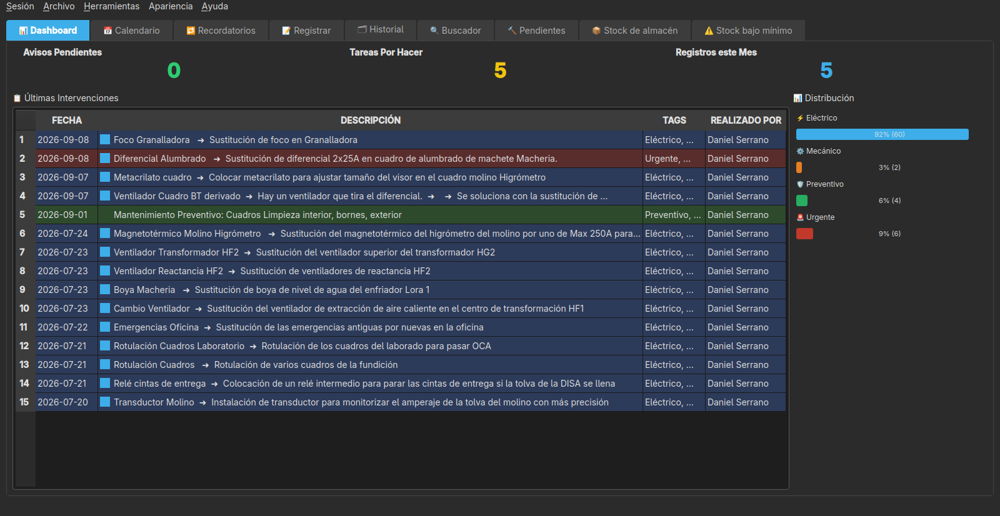
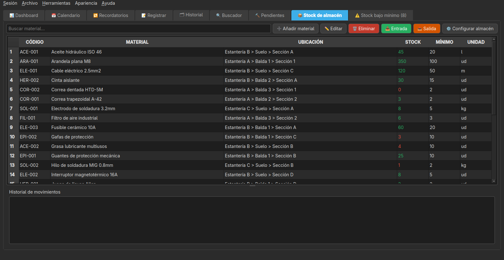
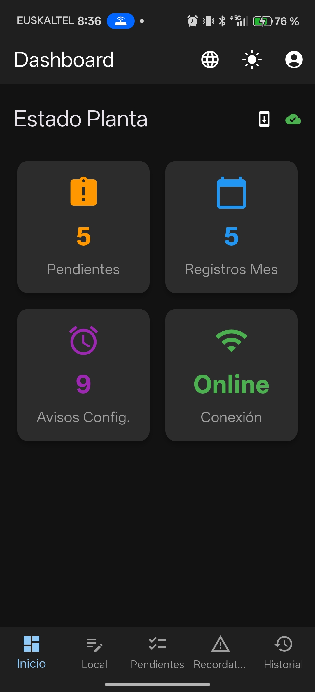
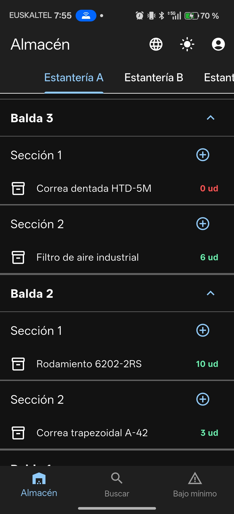
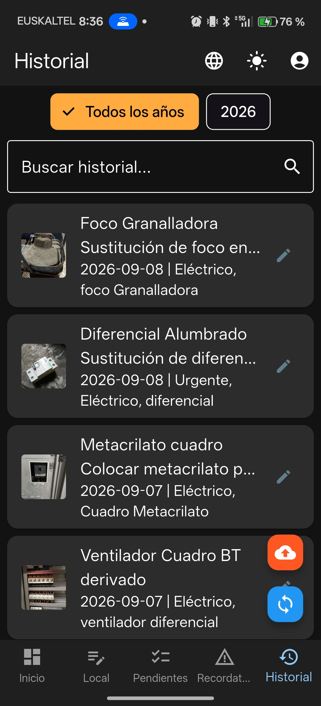

<p align="center">
  <a href="README.md"></a>
  <a href="README.es.md"></a>
  <a href="README.eu.md"></a>
  <a href="README.ca.md"></a>
  <a href="README.gl.md"></a>
  <a href="README.pt.md"></a>
</p>

# MantPro

<p align="center">
  
</p>

<p align="center">
  <strong>CMMS gratuito e de código aberto para gerenciar a manutenção preventiva e corretiva da sua planta, oficina ou frota, pelo PC e pelo Android.</strong>
</p>

<p align="center">
  
  
  
  
  
  
</p>

---

## 🧩 Que problema ele resolve?

Em muitas oficinas e plantas pequenas e médias, a manutenção é controlada entre
papéis, uma planilha do Excel compartilhada e mensagens de WhatsApp. Funciona,
até que alguém precisa saber **o que foi feito em uma máquina específica**,
quem fez, quando e com qual material — e essa informação está espalhada em três
lugares diferentes (ou em nenhum).

**O MantPro centraliza isso**: cada técnico registra sua intervenção pelo
celular, na hora, com fotos de antes e depois se necessário, e tudo fica
organizado no PC por máquina, por data e por pessoa, pronto para consultar ou
gerar um relatório em PDF.

## 🎯 Para quem é?

Pensado para quem cuida da manutenção do dia a dia, não para departamentos de
TI: técnicos de manutenção, responsáveis de planta, oficinas, pequenas e médias
indústrias e encarregados de almoxarifado que precisam de um controle real de
máquinas, intervenções e estoque sem depender de planilhas soltas.

## 🆚 Por que o MantPro e não um CMMS comercial?

- **Código aberto e grátis**: código aberto sob AGPL-3.0, sem limite de
  técnicos, máquinas ou registros
- **Sem assinatura**: não se paga por usuário nem por mês de uso
- **Seus dados, na sua infraestrutura**: o banco de dados fica no seu próprio
  PC; você não depende de que um serviço de nuvem de terceiros continue
  existindo no ano que vem
- **Offline de verdade**: o celular funciona sem conexão com a internet nem com
  o PC durante toda a jornada, e sincroniza assim que volta a ter rede
- **Feito a partir da própria manutenção**: as funções surgiram de
  necessidades reais de oficina (fotos de antes/depois, vínculo com a máquina,
  estoque de peças, avisos recorrentes...), não de uma lista genérica de
  requisitos de CMMS

## 🎬 Vídeo de demonstração

https://github.com/user-attachments/assets/11572710-e0ba-4f8b-b914-0a959006d4fb

## 📸 Capturas de tela

### Aplicativo para desktop

<p align="center">
  
  
</p>

### Aplicativo para celular

<p align="center">
  
  
  
</p>

---

## 📋 Índice

- [Que problema ele resolve?](#-que-problema-ele-resolve)
- [Para quem é?](#-para-quem-é)
- [Por que o MantPro?](#-por-que-o-mantpro-e-não-um-cmms-comercial)
- [Vídeo de demonstração](#-vídeo-de-demonstração)
- [Capturas de tela](#-capturas-de-tela)
- [Downloads](#-downloads)
- [Recursos](#-recursos)
- [Requisitos](#-requisitos)
- [Instalação](#-instalação)
- [Uso](#-uso)
- [Usuários e acesso](#-usuários-e-acesso)
- [Máquinas](#-máquinas)
- [Estoque do almoxarifado](#-estoque-do-almoxarifado)
- [Sincronização PC-celular](#-sincronização-pc-celular)
- [Cópias de segurança](#-cópias-de-segurança)
- [Estrutura do projeto](#-estrutura-do-projeto)
- [Contribuir](#-contribuir)
- [Licença](#-licença)
- [Contato](#-contato)

---

## 📦 Downloads

Você pode baixar as versões pré-compiladas em [GitHub Releases](https://github.com/AnabasaSoft/MantPro/releases):

- **Windows**: executável `.exe` para Windows
- **Linux**:
  - Binário executável para Linux
  - AppImage portátil
  - Também disponível no **AUR** (Arch User Repository)
- **Android**: arquivos `.apk` para instalação direta
  - `MantPro.apk`: aplicativo de serviços de manutenção
  - `MantProStock.apk`: aplicativo de estoque do almoxarifado

---

## ✨ Recursos

### 💻 Aplicativo para desktop (PC)

- **👥 Gerenciamento de usuários**: login com usuário e senha, funções de administrador e técnico, cadastro e desativação de usuários e redefinição de senhas
- **✍️ Autoria dos serviços**: cada intervenção guarda quem a realizou, visível no histórico e nos relatórios
- **🔒 Permissões por registro**: um técnico só pode editar ou excluir seus próprios serviços; um administrador pode gerenciar qualquer um, inclusive reatribuir o autor de um ou vários registros de uma vez
- **📋 Auditoria de alterações**: registro de quem edita ou exclui cada serviço (não só de quem o criou), consultável e filtrável por técnico e por tipo de ação em "Registro de alterações" (somente administradores)
- **🔐 Sessões de dispositivos**: lista os celulares vinculados a cada usuário, com o modelo real, e permite revogar uma ou várias sessões específicas sem desativar o usuário inteiro (somente administradores). Ao entrar de novo pelo mesmo dispositivo, a sessão anterior é substituída automaticamente em vez de se acumular
- **📊 Painel com KPIs e gráficos**: cartões de avisos pendentes, tarefas a fazer, registros do mês e MTBF/MTTR médios de toda a planta, além de gráficos das máquinas com mais falhas e de falhas por mês, desenhados sem depender de bibliotecas externas
- **🎨 Temas visuais**: escolha entre modo escuro (padrão), claro ou um estilo retrô inspirado no Windows 98, no menu "Aparência"
- **📅 Calendário interativo**: visualize e gerencie as tarefas de manutenção com códigos de cores (feriados, férias, dias com tarefas)
- **📝 Histórico completo**: registro histórico de todas as intervenções realizadas, com fotos de antes/depois e uma **coleção de fotos** adicional por serviço; é possível excluir vários registros de uma vez
- **📄 Relatórios em PDF**: geração automática de relatórios profissionais com logo personalizável
- **📸 Gerenciamento de imagens**: armazenamento e visualização das fotos das intervenções
- **📱 Sincronização com o celular**: servidor integrado (inicia automaticamente) para sincronizar com o aplicativo do celular via QR
- **🔍 Sistema de busca**: busca avançada por datas, tags e conteúdo
- **👤 Filtro por técnico**: filtre o histórico e as exportações (PDF, CSV e Excel) pela pessoa que fez o serviço
- **📦 Backup e restauração**: cópia manual completa (BD + fotos) escolhendo onde salvá-la, backup automático incremental ao fechar o aplicativo (veja [Cópias de segurança](#-cópias-de-segurança)) e restauração com barra de progresso, com o submenu `Arquivo > ♻️ Restaurar` para escolher entre qualquer backup manual ou ir direto às cópias automáticas
- **🏷️ Sistema de tags**: classificação com etiquetas (Urgente, Elétrico, Mecânico, Preventivo)
- **🔨 Tarefas pendentes**: gerenciamento de serviços pendentes (criar, concluir, editar, excluir) e **atribuição a um técnico específico**
- **🚦 Prioridade dos pendentes**: cada serviço pendente tem uma prioridade (Baixa, Média, Alta ou Crítica) para decidir qual atacar primeiro, com sua cor na lista; também é possível anexar fotos à coleção dele
- **↩️ Reverter para pendente**: se um serviço foi concluído por engano, ele pode voltar para Pendentes com um clique a partir do histórico (com aviso se tinha máquina vinculada, já que esse dado se perderia), ficando registrado na auditoria
- **🔁 Lembretes**: avisos de manutenção que se repetem automaticamente. Se a data passar, eles não são pulados: ficam **Pendentes** (laranja) durante a margem e depois **Atrasados** (vermelho) até serem feitos, e a próxima data é contada a partir do dia em que o serviço foi realmente feito
- **📦 Controle do estoque do almoxarifado**: estrutura configurável de estantes, prateleiras e seções, ficha de materiais com foto, entradas/saídas com histórico e alertas de estoque abaixo do mínimo
- **📄 Exportar o estoque**: botão "📄 Exportar" na aba de estoque para gerar o almoxarifado inteiro, uma zona ou uma estante em PDF, CSV ou Excel, ordenado por localização; a aba de estoque abaixo do mínimo também tem seu botão para exportar apenas os materiais em alerta
- **🗑️ Tempo máximo de armazenamento**: `Ferramentas` permite excluir do histórico os serviços mais antigos que um número de anos, meses ou dias, com suas fotos e uma cópia de segurança prévia (somente administradores)
- **🏭 Controle de máquinas**: árvore de máquinas e submáquinas com foto anexada, contador de serviços por ano e mês e vínculo direto a partir de cada serviço registrado ou editado (veja [Máquinas](#-máquinas))
- **📊 Exportação**: para PDF, CSV e Excel, com filtro opcional por técnico e indicando a máquina/submáquina de cada serviço, se houver

### 📱 Aplicativo para celular (Android)

- **🔐 Acesso com usuário**: cada técnico entra uma vez e a sessão fica salva no dispositivo
- **📝 Registro rápido**: registro de intervenções em campo, assinadas automaticamente com o seu usuário
- **📷 Câmera integrada**: tire fotos e edite-as com anotações
- **🖼️ Coleção de fotos**: além das fotos de antes e depois, adicione a um serviço ou pendente quantas fotos quiser (câmera ou galeria); ao tocar em qualquer foto, ela é exibida em tela cheia, passando de uma para outra e ampliando com dois dedos
- **✏️ Editor de imagens**: desenhe sobre as fotos para marcar áreas de interesse
- **🔄 Sincronização automática**: envio automático dos dados para o PC via código QR
- **💾 Armazenamento local**: guarda os registros offline até sincronizar
- **📋 Serviços pendentes**: visualize e gerencie as tarefas atribuídas pelo PC, com o filtro **"Só os meus"**
- **🔄 Atualização ao abrir**: ao iniciar, o aplicativo sincroniza em segundo plano os dados de todas as abas
- **🔁 Sincronizar manualmente**: as abas Pendentes, Histórico e Lembretes têm seu próprio botão para reenviar na hora o que o celular tiver e o PC ainda não
- **↩️ Reverter para pendente**: mantendo pressionado um registro do Histórico, ele pode voltar para a aba Pendentes se foi concluído por engano
- **🏷️ Tags rápidas**: sistema de etiquetas rápido com caixas de seleção
- **🔌 Modo offline**: trabalhe sem conexão e sincronize quando puder
- **⏰ Lembretes diários**: notificação automática às 8:00 (horário local) se houver serviços pendentes não concluídos
- **🧰 Material usado**: adicione ao serviço o material do almoxarifado que você usou, buscando pelo nome ou código; ele é descontado do estoque automaticamente ao salvar (veja [Material usado em um serviço](#-estoque-do-almoxarifado))
- **🏭 Vincular máquina**: escolha em uma lista a máquina ou submáquina em que o serviço foi feito, tanto ao criar um registro novo quanto ao editar um já sincronizado do histórico

### 📦 Aplicativo de estoque para celular (Android)

Aplicativo independente (`mantpro_stock_app`), pensado para consultar e
movimentar o estoque do almoxarifado pelo celular sem precisar do aplicativo de
serviços.

- **🔐 Acesso com usuário**: usa o mesmo sistema de usuários e sessão do aplicativo de serviços
- **🗂️ Navegação pelo almoxarifado**: árvore de estantes > prateleiras > seções, igual ao PC
- **🔎 Busca de materiais**: por nome, código, descrição ou localização
- **➕➖ Entradas e saídas**: registre movimentações de estoque pelo celular, com motivo opcional
- **🔀 Transferências**: mover um material de seção fica registrado no histórico de movimentações dele
- **🎨 Aviso visual de estoque**: quantidade em vermelho abaixo do mínimo, em verde acima e na cor padrão se for exatamente igual
- **⚠️ Estoque abaixo do mínimo**: aba dedicada aos materiais em alerta
- **🔄 Atualização automática**: a tela se atualiza sozinha ao detectar alterações, feitas tanto no próprio celular quanto no PC
- **🔌 Modo offline**: sem conexão com o PC, o aplicativo não fica esperando: consulta os dados salvos e permite registrar cadastros, edições, entradas e saídas na hora, que são enviados sozinhos ao PC assim que ele voltar a estar acessível
- **🔔 Lembrete diário de conferência de estoque**: notificação automática às 8:00 (horário local) convidando a conferir a quantidade real de 5 materiais do almoxarifado, escolhidos ao acaso e diferentes a cada dia; ao tocá-la, abre-se uma tela para corrigir a quantidade de cada um sem precisar procurá-los. Se não houver nenhum material cadastrado, nenhuma notificação é exibida

---

## 🔧 Requisitos

### Aplicativo para desktop

- **Python**: 3.8 ou superior
- **Sistema operacional**: Windows ou Linux
- **Dependências do Python**:
  - PyQt6
  - Flask
  - ReportLab
  - qrcode
  - requests
  - xlsxwriter
  - sqlite3 (incluído no Python)

### Aplicativo para celular

Vale tanto para o `mantenimiento_app` (serviços) quanto para o `mantpro_stock_app` (estoque):

- **Flutter**: 3.0 ou superior
- **Dart SDK**: 2.17 ou superior
- **Android**: API Level 21+ (Android 5.0+)

---

## 📥 Instalação

### Aplicativo para desktop

#### Opção 1: download pré-compilado (recomendado)

Baixe a versão correspondente ao seu sistema em [GitHub Releases](https://github.com/AnabasaSoft/MantPro/releases):

- **Windows**: baixe e execute o `.exe`
- **Linux**:
  - Baixe o binário executável e dê permissão de execução: `chmod +x mantpro`
  - Ou use o **AppImage** (sem instalação): `chmod +x MantPro.AppImage && ./MantPro.AppImage`
  - Os pacotes **`.deb`** e **`.rpm`** são assinados digitalmente com GPG (veja [Verificar a assinatura dos pacotes](#-verificar-a-assinatura-dos-pacotes-linux))
  - **Arch Linux**: disponível no AUR: `yay -S mantpro` ou `paru -S mantpro`

#### 🔏 Verificar a assinatura dos pacotes (Linux)

Os pacotes `.deb` e `.rpm` publicados em cada release são assinados com a chave GPG oficial da AnabasaSoft. Para verificá-los antes de instalar:

1. Baixe a chave pública do repositório ([`firma/anabasasoft_public.asc`](firma/anabasasoft_public.asc)) para um arquivo (**não use `curl | rpm --import -`**: algumas versões do `rpm` não aceitam ler a chave pela entrada padrão e falham):
   ```bash
   curl -sL https://raw.githubusercontent.com/AnabasaSoft/MantPro/main/firma/anabasasoft_public.asc -o /tmp/anabasasoft_public.asc
   ```

2. Importe a chave (só é preciso uma vez por computador):
   ```bash
   # Fedora, openSUSE, RHEL... (pacote .rpm)
   sudo rpm --import /tmp/anabasasoft_public.asc

   # Debian, Ubuntu... (pacote .deb, requer dpkg-sig)
   gpg --import /tmp/anabasasoft_public.asc
   ```

3. Verifique se a chave foi importada corretamente:
   ```bash
   rpm -qa 'gpg-pubkey*' --qf '%{name}-%{version}-%{release} --> %{summary}\n' | grep -i anabasasoft
   ```

4. Verifique a assinatura do pacote baixado:
   ```bash
   # RPM
   rpm --checksig mantpro-*.rpm

   # DEB
   dpkg-sig --verify mantpro_*.deb
   ```
   Uma assinatura correta mostra `OK` na linha da assinatura (em vez de `NOKEY` ou `MISSING KEYS`).

Uma assinatura válida confirma que o pacote vem da AnabasaSoft e que não foi modificado.

#### Opção 2: instalação a partir do código-fonte

1. **Clonar o repositório**:
   ```bash
   git clone https://github.com/AnabasaSoft/MantPro.git
   cd MantPro
   ```

2. **Criar um ambiente virtual** (recomendado):
   ```bash
   python -m venv venv
   source venv/bin/activate  # No Windows: venv\Scripts\activate
   ```

3. **Instalar as dependências**:
   ```bash
   pip install -r requirements.txt
   ```

4. **Executar o aplicativo**:
   ```bash
   python main.py
   ```

### Aplicativo para celular

#### Opção 1: download direto (recomendado)

Baixe o `.apk` correspondente em [GitHub Releases](https://github.com/AnabasaSoft/MantPro/releases) e instale-o no seu dispositivo Android: `MantPro.apk` para os serviços, `MantProStock.apk` para o estoque do almoxarifado. São aplicativos independentes e você pode instalar um, o outro ou os dois.

**Observação**: talvez seja necessário habilitar "Fontes desconhecidas" nas configurações de segurança do dispositivo.

#### Opção 2: compilar a partir do código-fonte

1. **Entrar no diretório do aplicativo** (`mantenimiento_app` para os serviços, `mantpro_stock_app` para o estoque):
   ```bash
   cd mantenimiento_app
   ```

2. **Instalar as dependências**:
   ```bash
   flutter pub get
   ```

3. **Executar em um dispositivo ou emulador**:
   ```bash
   flutter run
   ```

4. **Compilar o APK (Android)**:
   ```bash
   flutter build apk --release
   ```

---

## 🚀 Uso

### Primeira configuração

#### Aplicativo para desktop

1. **Iniciar o aplicativo**: execute `python main.py` (o servidor de sincronização inicia sozinho, não é preciso iniciá-lo manualmente)
2. **Primeiro acesso**: na primeira execução é criado o usuário `admin` com a senha `admin`. O aplicativo **obriga a alterá-la** ao entrar
3. **Criar os usuários**: menu `Ferramentas` > `👥 Gerenciamento de usuários` > cadastre cada técnico
4. **Configurar o logo** (opcional): menu `Arquivo` > `📄 Opções de PDF` > `🖼️ Adicionar / Alterar Logo`
5. **Registrar um serviço**: aba "📝 Registrar" > preencha o resumo e os detalhes > "💾 SALVAR REGISTRO"
6. **Criar um pendente**: aba "🔨 Pendentes" > grupo "Novo Serviço" (Título + Detalhes + "Atribuir a") > "Adicionar"

#### Aplicativo para celular

1. **Instalar o aplicativo** no seu celular
2. **Conectar ao PC**:
   - Verifique se o PC e o celular estão na mesma rede Wi-Fi
   - No PC: menu `Ferramentas` > `📲 Sincronizar App (QR)`
   - No celular: toque em "Vincular PC" e escaneie o código
3. **Entrar**: informe o usuário e a senha que o administrador criou para você. A sessão fica salva: só é preciso fazer isso uma vez
4. **Pronto**: você já pode registrar intervenções pelo celular

### Fluxo de trabalho típico

#### Pelo PC

1. **Criar e atribuir uma tarefa pendente**:
   - Aba "🔨 Pendentes" > grupo "Novo Serviço" > preencha o Título e os Detalhes, escolha o técnico em "Atribuir a" > "Adicionar"
   - Gerencie-a com os botões "✅ Concluir", "✏️ Editar", "❌ Excluir" ou "👤 Reatribuir"
   - A lista "Ver os de" filtra por técnico (inclui "Sem atribuição")

2. **Revisar os serviços concluídos**:
   - Os serviços sincronizados pelo celular aparecem automaticamente
   - Confira as fotos (antes/depois e coleção) e os detalhes na aba "📋 Histórico" ou no "📅 Calendário"
   - A coluna "Realizado por" indica quem fez cada serviço, e a lista acima permite ver apenas os de uma pessoa

3. **Gerar relatórios**:
   - Menu `Arquivo` > `📄 Opções de PDF` > `📄 Gerar PDF Agora`
   - Na janela você pode escolher o técnico, e o nome dele aparece no título do relatório
   - Ou exporte para `📄 CSV` / `📊 Excel` no mesmo menu `Arquivo`

#### Pelo celular

1. **Vincular ao PC e entrar** (só na primeira vez, ou se mudar de rede):
   - Toque em "Vincular PC" e escaneie o QR exibido pelo PC
   - Informe seu usuário e senha
   - O celular guarda o endereço do PC e a sua sessão para sincronizar automaticamente a partir daí

2. **Registrar uma intervenção**:
   - Toque em "Novo" ou selecione um serviço pendente já sincronizado pelo PC
   - Com o filtro "Só os meus" você vê apenas os serviços atribuídos a você
   - Preencha o título e os detalhes
   - Tire a foto de "antes" e, se quiser, a de "depois" com a câmera; se precisar, adicione mais à coleção de fotos
   - Desenhe ou faça anotações na foto, se necessário
   - Selecione as tags adequadas
   - Salve

3. **Sincronizar**:
   - Ao abrir o aplicativo, tudo é sincronizado em segundo plano (você verá um indicador na barra superior)
   - Você também pode forçar a sincronização puxando a lista para baixo ou com o ícone de sincronização
   - Os registros são enviados ao PC e removidos do celular quando o envio é confirmado
   - Tudo funciona sem conexão: o que estiver pendente fica salvo e é enviado quando houver sinal

---

## 👥 Usuários e acesso

### Funções

Um mesmo usuário pode ter **uma ou várias funções ao mesmo tempo** (por
exemplo, técnico e almoxarifado). Funções disponíveis:

| Função | O que pode fazer |
|--------|------------------|
| **Administrador** | Tudo o que o técnico e o almoxarifado fazem, além de cadastrar e desativar usuários, alterar funções, redefinir senhas, editar ou excluir **qualquer** registro do histórico, reatribuir o autor de um ou vários registros de uma vez e consultar o registro de auditoria de alterações |
| **Técnico** | Registrar serviços, concluir pendentes e avisos, editar ou excluir **apenas os próprios** registros do histórico e alterar a própria senha |
| **Almoxarifado** | Cadastrar ou editar materiais e registrar entradas/saídas de estoque pelo aplicativo **MantPro Stock** |

Sempre deve existir **pelo menos um administrador ativo**: o aplicativo impede
remover a função ou desativar o último que restar.

> No aplicativo para desktop, qualquer usuário (seja qual for sua função) pode
> registrar movimentações de estoque; a função **Almoxarifado** é o que habilita
> esse mesmo gerenciamento (cadastros, edições e movimentações) pelo celular.

### Gerenciamento pelo PC

- **Cadastro**: `Ferramentas` > `👥 Gerenciamento de usuários` > preencha
  usuário, nome, senha e função > "➕ Adicionar". Se você deixar marcado "Pedir
  alteração ao entrar", a pessoa terá de definir a própria senha no primeiro
  acesso.
- **Desativação**: é feita de forma **lógica** (o usuário fica inativo). Ele
  nunca é apagado, para não quebrar a autoria dos serviços que já fez.
- **Redefinir senha**: útil quando alguém a esquece. Ao alterá-la, todas as
  sessões abertas dessa pessoa no celular são encerradas automaticamente.
- **Alterar a própria senha**: `Ferramentas` > `🔑 Alterar minha senha`.

### Sessões de dispositivos

`Ferramentas` > `🔐 Sessões de dispositivos` (somente administradores) lista
todas as sessões abertas no celular de todos os usuários, com o modelo do
dispositivo, quando começou, quando expira e se continua ativa ou já expirou.
É possível selecionar uma ou várias linhas e revogá-las, o que encerra a sessão
daquele celular sem precisar desativar o usuário inteiro (o que encerraria
*todos* os dispositivos dele de uma vez).

Se um usuário entrar de novo por um dispositivo em que já tinha uma sessão
aberta (mesmo fabricante e modelo), a sessão anterior desse dispositivo é
apagada automaticamente ao criar a nova, em vez de ficar acumulada como mais
uma sessão solta na lista.

### Autoria dos serviços

Cada registro guarda o técnico que o fez, tenha sido criado no PC ou vindo do
celular. Os registros anteriores à implantação do sistema de usuários ficaram
marcados como **`Histórico`**.

No celular, a atribuição é decidida **sempre pelo servidor** a partir do token
da sessão, nunca por um dado enviado pelo aplicativo. Um dispositivo não pode
assinar serviços em nome de outra pessoa.

Pelo PC, um técnico só pode editar ou excluir os próprios registros do
histórico; um administrador pode fazer isso com qualquer um. Clicando com o
botão direito sobre uma ou várias linhas do histórico (seleção múltipla com
Ctrl/Shift), um administrador também pode **reatribuir o autor** em bloco, e
cada alteração fica anotada no registro de auditoria.

### Registro de alterações (auditoria)

Sempre que um serviço é editado ou excluído, fica registrado quem fez, quando e
o que mudou. Os administradores podem consultar isso em
`Ferramentas` > `📋 Registro de alterações`, com filtros por técnico e por tipo
de ação (editar/excluir).

### Sessão no celular

O técnico entra uma vez e o token fica salvo no dispositivo. A sessão é
encerrada sozinha se o administrador desativar o usuário ou redefinir a senha
dele; nesse caso, o aplicativo volta para a tela de acesso **sem perder os
registros que ainda estiverem pendentes de envio**.

---

## 🏭 Máquinas

> Gerenciamento disponível no aplicativo para desktop, com o vínculo à máquina
> também selecionável pelo celular ao registrar ou editar um serviço.

Aba "🏭 Máquinas" do PC, pensada para acompanhar as falhas e intervenções de
cada equipamento ao longo do tempo.

- **🌳 Árvore de máquinas**: as máquinas podem ter submáquinas (por exemplo,
  uma linha com vários equipamentos), formando uma hierarquia tão profunda
  quanto necessário
- **📅 Serviços organizados por ano e mês**: ao expandir uma máquina aparecem
  os anos com serviços e, ao expandir um ano, os meses; cada nível mostra um
  contador de quantos serviços tem, com carregamento sob demanda para não
  deixar a árvore lenta
- **🖱️ Acesso direto ao serviço**: com um clique duplo sobre um serviço da
  árvore, abre-se diretamente a ficha de edição dele
- **📸 Foto da máquina**: cada máquina ou submáquina pode ter uma foto anexada,
  visível em um quadro ao lado da árvore ao selecioná-la
- **🔗 Vínculo a partir de cada serviço**: ao registrar um serviço novo (PC ou
  celular) ou editar um existente, é possível escolher a qual
  máquina/submáquina ele pertence
- **📊 Nas exportações**: a máquina ou submáquina vinculada aparece como coluna
  adicional nas exportações para PDF, CSV e Excel

---

## 📦 Estoque do almoxarifado

> Gerenciamento completo pelo aplicativo para desktop, com consulta e
> movimentações também disponíveis pelo celular (`mantpro_stock_app`). Fica
> em um banco de dados próprio (`almacen.db`), independente do dos serviços de
> manutenção.

### Estrutura do almoxarifado

O almoxarifado é organizado em três níveis, inspirados nas convenções
habituais de endereçamento de almoxarifados:

```
Estante → Prateleira → Seção
```

- Ao criar uma estante, define-se o **número de prateleiras**, o **número de
  seções por prateleira** (0 = sem seções predefinidas, que podem ser
  adicionadas depois) e se ela tem **espaço no chão** abaixo da prateleira
  inferior, tratado como uma prateleira especial ("Chão")
- As prateleiras são numeradas de baixo para cima a partir de 1, para poder
  adicionar prateleiras novas sem renumerar as existentes
- Não é possível excluir uma estante, prateleira ou seção enquanto houver
  material guardado nela

A estrutura é gerenciada pelo botão **"⚙️ Configurar almoxarifado"** da aba
"📦 Estoque do almoxarifado", visível **somente para administradores**.

### Materiais

- Cadastro e edição com código (opcional), nome, descrição, unidade, estoque
  mínimo, localização (estante / prateleira / seção) e **foto anexada**
- Busca por **nome, código, descrição ou localização**
- O estoque é destacado em **vermelho** abaixo do mínimo, em **verde** acima e
  na cor padrão se for exatamente igual ao mínimo, tanto no PC quanto no
  celular
- Selecionando vários materiais de uma vez (Ctrl/Shift + botão direito) no PC,
  é possível **mudá-los de localização** ou **excluí-los** em bloco

### Entradas, saídas e transferências

- **Qualquer usuário** pode registrar entradas e saídas de estoque; somente a
  configuração da estrutura do almoxarifado é restrita a administradores
- Cada movimentação fica registrada com data, quantidade, usuário e um motivo
  opcional, visível no histórico de cada material
- As saídas registradas manualmente (PC ou `mantpro_stock_app`) não podem
  deixar o estoque negativo
- Mudar um material de localização também fica registrado no histórico dele,
  como uma movimentação do tipo **transferência** (de qual seção para qual
  seção)

### Material usado em um serviço (MantPro)

Ao concluir um serviço pelo aplicativo **MantPro** (celular), é possível
adicionar o material usado, buscando-o pelo nome ou código e informando a
quantidade. Ao salvar o serviço, esse material é descontado automaticamente do
almoxarifado, com o motivo "Usado em serviço: ..." para manter a
rastreabilidade.

Ao contrário das saídas manuais, **esse desconto pode deixar o estoque
negativo**: o material já foi usado fisicamente no serviço, mesmo que não
houvesse estoque registrado suficiente, então bloquear a movimentação não
faria sentido. O estoque negativo aparece tanto no PC quanto no
`mantpro_stock_app` e serve de aviso de que é preciso conferir e repor esse
material o quanto antes.

### Alertas de estoque abaixo do mínimo

A aba **"⚠️ Estoque abaixo do mínimo"** mostra, em uma visualização separada,
os materiais sem estoque ou abaixo do mínimo definido. O próprio título da aba
indica quantos materiais estão em alerta, e dali é possível ir direto ao
material em "Estoque do almoxarifado", registrar uma entrada sem trocar de aba
ou exportar a lista com o botão "📄 Exportar".

### Exportar o estoque

Na aba **"📦 Estoque do almoxarifado"** do PC, o botão **"📄 Exportar"** abre
uma janela para escolher o **formato** (PDF, CSV ou Excel) e **o que
exportar**: o almoxarifado inteiro, uma zona ou uma só estante. A lista sai
ordenada por localização, para percorrer o almoxarifado com ela em mãos; o PDF
e o Excel incluem ainda a data, o número de materiais e quantos estão abaixo
do mínimo (em vermelho). A própria tabela de estoque também é exibida ordenada
por localização por padrão (Estante 1, 2… 10).

---

## 🔄 Sincronização PC-celular

### Como funciona

O MantPro usa um sistema de sincronização baseado em:

1. **Servidor Flask** integrado ao aplicativo para desktop
2. **Códigos QR** para uma conexão rápida e segura
3. **API REST autenticada por token**: todos os endpoints de dados exigem uma
   sessão válida; se o token deixar de valer, o servidor responde `401` e o
   celular volta para a tela de login
4. **Wi-Fi local**, sem precisar de internet
5. **Sincronização completa ao abrir o aplicativo**, em segundo plano e sem
   travar a interface

> ⚠️ O tráfego passa por **HTTP dentro da rede local**. O sistema de usuários
> oferece rastreabilidade (saber quem fez cada serviço), não proteção contra
> alguém com acesso a essa mesma rede.

### Configuração da rede

Para que a sincronização funcione:

- ✅ O PC e o celular devem estar na **mesma rede Wi-Fi**
- ✅ O **firewall** deve permitir conexões na porta 5000 (ou na configurada)
- ✅ No Windows, talvez seja preciso criar uma exceção no firewall

### Solução de problemas

**O celular não conecta ao PC:**
- Verifique se os dois dispositivos estão na mesma rede
- Confira se o servidor está ativo no PC (ícone verde)
- Tente desativar temporariamente o firewall do PC
- Gere o código QR novamente e escaneie-o de novo

**Não consigo entrar pelo celular:**
- Confira se o MantPro está aberto no PC: o login é validado nele
- Confirme o usuário e a senha com o administrador; ele pode redefini-la
- Se o PC mudou de IP, escaneie o QR de novo pela própria tela de login ("Vincular outro PC")

**O aplicativo me levou de volta à tela de acesso:**
- É normal se o administrador redefiniu sua senha ou desativou seu usuário
- Seus registros não enviados **não se perdem**: entre de novo e eles serão sincronizados

**Esqueci a senha de administrador:**
- Outro administrador pode redefini-la em `Ferramentas` > `👥 Gerenciamento de usuários`
- Se não houver nenhum outro administrador, é preciso redefini-la diretamente
  na tabela `usuarios` do banco de dados

**As fotos não sincronizam:**
- Verifique se há espaço suficiente no disco do PC
- Confira as permissões da pasta `fotos_recibidas`
- Verifique se a foto foi salva corretamente no celular

**Não recebo a notificação diária de avisos pendentes (Android):**
- Confira se a permissão de notificações está concedida: `Configurações → Apps → MantPro → Notificações`
- Em fabricantes como **OPPO/Realme (ColorOS), Xiaomi (MIUI) ou Huawei**, o sistema pode encerrar o alarme programado mesmo com a permissão concedida. Além disso, é preciso:
  - `Configurações → Bateria → Uso da bateria por app → MantPro` → deixar como **"Sem restrições"**
  - `Configurações → Bateria → Inicialização automática` → **ativar** o MantPro
- A notificação é reavaliada sempre que você abre o Painel; então, se acabou de marcar um serviço como concluído, abra-o de novo para que ela seja cancelada ou reprogramada corretamente.

**Não recebo a notificação diária de conferência de estoque (MantPro Stock):**
- Valem as mesmas verificações do MantPro (permissão de notificações e exclusão da otimização de bateria, veja acima)
- Se o almoxarifado não tiver nenhum material cadastrado, nenhuma notificação é exibida: é o comportamento esperado
- Ela é reavaliada sempre que o aplicativo sincroniza com o PC (ao abrir e a cada 25 segundos enquanto está aberto)

### 🔒 Observação sobre segurança

A sincronização passa por HTTP dentro da rede local. O sistema de usuários foi
pensado para a **rastreabilidade** (saber quem fez cada serviço), não como
barreira contra alguém com acesso a essa mesma rede. Se no futuro o servidor
for exposto fora da rede local, o tráfego deve ser criptografado (VPN ou túnel
com HTTPS).

---

## 💾 Cópias de segurança

O MantPro distingue dois tipos de cópia, pensados para momentos diferentes:

### Backup automático (ao fechar o aplicativo)

Sempre que o programa é fechado, é feito em segundo plano, sem precisar de
intervenção, um backup rápido pensado para não pesar, mesmo com o passar dos
anos:

- **Bancos de dados**: `mantenimiento.db` e `almacen.db` são empacotados
  inteiros em um ZIP (`auto_backup_db_<data>.zip`) a cada vez, em rodízio,
  guardando apenas os 3 mais recentes.
- **Fotos**: em vez de compactar todo o histórico de fotos a cada fechamento,
  são mantidos ZIPs incrementais por ano (`fotos_backup_<ano>.zip`): cada
  fechamento só adiciona ao ZIP do ano correspondente as fotos que ainda não
  estavam nele, sem mexer nem recompactar as de anos anteriores. Assim o tempo
  de fechamento não cresce com o tempo de uso do aplicativo.

Enquanto essa cópia é feita, aparece uma janela com uma barra de progresso que
mantém o foco, e o fechamento real do aplicativo espera que ela termine.

### Backup manual (menu Arquivo)

`Arquivo > 💾 Backup` continua gerando, como sempre, um único ZIP
(`backup_completo_<data>.zip`) com os dois bancos de dados e **todas** as fotos
juntas e compactadas, no local que você escolher. `Arquivo > ♻️ Restaurar`
abre um submenu com duas opções: **"Restaurar..."**, para escolher qualquer ZIP
manualmente, e **"Restaurar a partir de cópia automática..."**, que abre
diretamente a pasta `backups_auto`. Nos dois casos, se o ZIP escolhido for um
backup automático, o banco de dados é restaurado primeiro e, com ele já
restaurado, calcula-se quais fotos são necessárias e elas são extraídas apenas
dos `fotos_backup_<ano>.zip` correspondentes, em vez de despejar todas. As três
operações (backup e as duas restaurações) mostram sua própria barra de
progresso com foco.

### Limpeza de fotos órfãs

`Ferramentas > 🧹 Limpar Fotos Inúteis` apaga as fotos de `fotos_recibidas`
que não estejam mais referenciadas por nenhum serviço, pendente ou máquina. Ao
fechar o aplicativo e antes de um backup manual, `fotos_recibidas` também é
limpa em silêncio, mas **somente** essa opção do menu Ferramentas revisa também
os `fotos_backup_<ano>.zip` e os reescreve sem as fotos órfãs que possam
conter, para não arrastá-las indefinidamente.

### Tempo máximo de armazenamento de serviços

`Ferramentas > 🗑️ Tempo máximo de armazenamento de serviços…` (somente
administradores) pede um número e uma unidade (anos, meses ou dias) e exclui do
histórico todos os serviços anteriores a essa data, contando a partir de hoje.
Antes de excluir, mostra quantos serviços serão removidos e entre quais datas,
e pede confirmação.

- Antes de excluir, é salva uma cópia dos dois bancos de dados em
  `backups_auto/antes_borrado_trabajos_<data>.zip`, que o rodízio do backup
  automático não apaga.
- As fotos deles também são apagadas (antes, depois e coleção), exceto as que
  ainda forem usadas por outro registro. As fotos não entram nessa cópia
  prévia, mas continuam nos `fotos_backup_<ano>.zip` do backup automático até
  que se use `Ferramentas > 🧹 Limpar Fotos Inúteis`.
- Os celulares removem esses serviços do histórico na sincronização seguinte.
- É uma exclusão pontual: não se repete sozinha.

---

## 📁 Estrutura do projeto

```
MantPro/
├── main.py                      # Aplicativo principal para desktop
├── usuarios.py                  # Usuários, senhas, funções e sessões
├── dialogos_usuarios.py         # Janelas PyQt6: login e gerenciamento de usuários
├── almacen.py                   # Estoque do almoxarifado: estrutura, materiais e movimentações
├── maquinas.py                  # Árvore de máquinas e seu histórico de serviços
├── idiomas/                     # Traduções do desktop (ES / EN / EU / CA / GL / PT)
├── requirements.txt             # Dependências do Python
├── logo.png                     # Logo do aplicativo
├── README.pt.md                 # Este arquivo
├── fotos_recibidas/             # Pasta de imagens
├── mantenimiento.db             # Banco de dados SQLite (serviços de manutenção)
├── almacen.db                   # Banco de dados SQLite (estoque do almoxarifado, independente)
├── mantenimiento_app/           # Aplicativo Flutter para celular (serviços)
│   ├── lib/main.dart            # Código principal do celular
│   ├── lib/i18n/                # Traduções do celular (ES / EN / EU / CA / GL / PT)
│   ├── pubspec.yaml             # Dependências do Flutter
│   └── android/                 # Configuração do Android
├── mantpro_stock_app/           # Aplicativo Flutter para celular (estoque do almoxarifado)
│   ├── lib/modelos.dart         # Modelos de dados e regra de cor do estoque
│   ├── lib/pantallas/           # Telas: almoxarifado, item, busca, abaixo do mínimo...
│   ├── lib/i18n/                # Traduções do celular (ES / EN / EU / CA / GL / PT)
│   ├── pubspec.yaml             # Dependências do Flutter
│   └── android/                 # Configuração do Android
├── backups/                     # Backups manuais completos (BD + fotos)
├── backups_auto/                # Backups automáticos ao fechar (BD em rodízio + fotos por ano)
└── docs/                        # Documentação adicional
```

> Os dados (banco de dados, fotos e backups) não ficam necessariamente junto ao
> código: se não existir `mantenimiento.db` na pasta atual, o aplicativo usa
> `~/.local/share/MantPro` no Linux ou `%APPDATA%\MantPro` no Windows.

### Banco de dados

O aplicativo usa SQLite com as seguintes tabelas:

- **`tareas`**: registro das intervenções realizadas (data, descrição, tags,
  fotos, **quem a realizou** (`usuario_id` e `usuario_nombre`) e a **máquina
  vinculada** (`maquina_id`), se houver)
- **`maquinas`**: árvore de máquinas (nome, máquina superior, observações e
  foto)
- **`pendientes`**: tarefas pendentes (título, detalhes, prioridade e
  **técnico atribuído**: `asignado_a` e `asignado_nombre`)
- **`usuarios`**: pessoas que usam o aplicativo (login, nome, hash da senha,
  função e se está ativo)
- **`sesiones`**: tokens dos celulares vinculados, com a data de expiração
- **`avisos_recurrentes`**: avisos de manutenção que se repetem
  automaticamente
- **`dias_especiales`**: feriados, férias e dias marcados no calendário
- **`auditoria`**: histórico de quem edita ou exclui cada serviço, com data,
  ação e detalhe
- **`config`**: configuração interna do aplicativo (logo, província etc.)

As senhas são guardadas com **PBKDF2-SHA256** (200.000 iterações e salt por
usuário), nunca em texto puro. As tabelas e colunas novas são criadas sozinhas
na inicialização, sem perder os dados existentes.

> 🔐 O `mantenimiento.db` contém hashes de senhas e tokens de sessão. Ele está
> no `.gitignore` por um motivo: nunca o envie para o repositório.

O estoque do almoxarifado fica em um banco de dados próprio, **`almacen.db`**,
separado de propósito do dos serviços:

- **`estanterias`**: nome e se tem espaço no chão
- **`baldas`**: prateleiras de cada estante, numeradas de baixo para cima (a
  prateleira `0` representa o espaço no chão)
- **`secciones`**: subdivisões dentro de cada prateleira
- **`materiales`**: código, nome, descrição, unidade, estoque atual, estoque
  mínimo, localização (seção) e foto
- **`movimientos`**: histórico de entradas e saídas, com data, quantidade,
  usuário e motivo

Ele é criado automaticamente na primeira execução e entra nos backups (manuais
e automáticos ao fechar o aplicativo) junto com o `mantenimiento.db`.

---

## 🤝 Contribuir

Contribuições são bem-vindas! Se você quiser melhorar o MantPro:

1. Faça um **fork** do projeto
2. Crie uma **branch** para a sua alteração (`git checkout -b feature/MinhaMelhoria`)
3. Faça **commit** das alterações (`git commit -m 'Adiciona MinhaMelhoria'`)
4. Faça **push** da branch (`git push origin feature/MinhaMelhoria`)
5. Abra um **Pull Request**

---

## ✅ Feito

- **Gerenciamento de usuários**: login com usuário e senha no PC e no celular,
  várias funções por usuário (administrador / técnico / almoxarifado),
  cadastro e desativação lógica de usuários, alteração e redefinição de senha.
- **Autoria dos serviços**: cada registro guarda quem o realizou. Os registros
  anteriores ao sistema de usuários ficam marcados como `Histórico`.
- **Sessão persistente no celular**: o técnico entra uma vez e o token fica
  salvo no dispositivo.
- **API autenticada**: todos os endpoints de dados exigem token; um `401`
  encerra a sessão do celular e volta para o login sem perder os registros
  locais pendentes de envio.
- **Pendentes atribuídos**: o PC atribui cada serviço a um técnico e o celular
  pode filtrar por "Só os meus".
- **Filtro por técnico** no histórico e na exportação para PDF, CSV e Excel.
- **Auditoria de edições**: registra-se quem edita ou exclui um serviço (não só
  quem o criou), consultável e filtrável por técnico/ação em "Registro de
  alterações".
- **Permissões por registro**: um técnico só pode editar ou excluir os próprios
  serviços; um administrador pode gerenciar qualquer um e reatribuir o autor de
  um ou vários registros de uma vez (seleção múltipla + menu de contexto).
- **Temas visuais**: modo escuro (padrão), claro ou clássico no estilo Windows
  98, selecionável no menu "Aparência" e lembrado entre sessões.
- **Backup sob demanda com escolha do destino**: ao gerar uma cópia de
  segurança manual, é possível escolher onde salvá-la, em vez de ir sempre
  para a pasta `backups` padrão.
- **Controle do estoque do almoxarifado**: estrutura configurável de estantes,
  prateleiras e seções (somente administradores), ficha de materiais com foto,
  entradas e saídas com histórico (qualquer usuário), transferências entre
  localizações registradas no histórico, seleção múltipla com menu de contexto
  para mover ou excluir em bloco e uma aba dedicada aos materiais sem estoque
  ou abaixo do mínimo. Com banco de dados próprio (`almacen.db`) e aplicativo
  para celular independente (`mantpro_stock_app`) para consultar e movimentar
  o estoque pelo telefone.
- **Sessões de dispositivos**: listar os celulares vinculados a cada usuário,
  com o modelo real do dispositivo, e poder revogar uma ou várias sessões
  específicas sem precisar desativar o usuário inteiro.
- **Lista de máquinas**: árvore de máquinas e submáquinas com foto anexada,
  contador de serviços por ano e mês e vínculo de cada serviço (PC ou celular)
  à máquina em que foi feito, incluído nas exportações para PDF, CSV e Excel.
- **Backup automático incremental**: o fechamento do aplicativo não
  reempacota mais todo o histórico de fotos a cada vez; os bancos de dados
  fazem rodízio em um ZIP e as fotos ficam em ZIPs incrementais por ano, com
  uma barra de progresso com foco tanto no fechamento quanto no backup e na
  restauração manuais (veja [Cópias de segurança](#-cópias-de-segurança)).
- **Reverter um serviço para pendente**: desfazer a conclusão de um serviço
  feita por engano, tanto pelo histórico do PC quanto mantendo pressionado o
  registro no celular, com aviso de perda da máquina vinculada, se houver, e
  restauração automática do aviso recorrente de origem, se vier de um.
- **Restaurar a partir de cópia automática**: `Arquivo > ♻️ Restaurar` abre um
  submenu para escolher entre qualquer backup manual ou ir direto à pasta de
  cópias automáticas feitas ao fechar o aplicativo.
- **Lembrete diário de estoque**: o aplicativo `mantpro_stock_app` avisa toda
  manhã às 8:00 para conferir a quantidade real de 5 materiais do almoxarifado
  (ao acaso, diferentes a cada dia) e permite corrigi-la na hora pela própria
  notificação.
- **Painel com KPIs e gráficos de confiabilidade**: cartões de MTBF e MTTR
  médios de toda a planta e gráficos de ranking das máquinas com mais falhas e
  de falhas por mês, desenhados à mão com `QPainter` sem depender de nenhuma
  biblioteca de gráficos externa.
- **Substituição automática da sessão por dispositivo**: se um usuário entrar
  de novo por um celular em que já tinha uma sessão aberta, a anterior é
  apagada sozinha em vez de se acumular na lista de sessões.
- **Coleção de fotos por serviço**: além de antes e depois, qualquer número de
  fotos extras em serviços e pendentes, no PC e no celular, com um visualizador
  em tamanho real que passa de uma para outra.
- **Avisos recorrentes que não são pulados**: um aviso atrasado fica pendente
  (laranja) ou atrasado (vermelho) até ser feito, e o ciclo seguinte é contado
  a partir da data em que foi realmente feito.
- **Exportar o estoque do almoxarifado** para PDF, CSV ou Excel, completo, por
  zona, por estante ou só os materiais abaixo do mínimo.
- **Tempo máximo de armazenamento de serviços**: exclusão de serviços antigos
  com confirmação e cópia de segurança prévia.

## 📄 Licença

Este projeto está sob a **GNU Affero General Public License v3.0 (AGPL-3.0)**.
Consulte o arquivo `LICENSE` para o texto completo.

Copyright (C) 2026 AnabasaSoft

### O que isso significa na prática

- ✅ Você pode **usar** o MantPro livremente, inclusive na sua empresa e com fins comerciais
- ✅ Você pode **estudar, modificar e redistribuir** o código
- ⚠️ Se distribuir uma versão modificada, deve publicá-la **também sob AGPL-3.0**
- ⚠️ Se oferecer o MantPro (ou um derivado) **como serviço por meio de uma rede**,
  deve disponibilizar o código-fonte a quem o usar, mesmo que não distribua
  nenhum executável. Essa é a principal diferença em relação à GPL v3
- ⚠️ Você deve manter os avisos de copyright e de licença

### Aviso de licença

```
MantPro - Sistema de Manutenção Preventiva
Copyright (C) 2026 AnabasaSoft

Este programa é software livre: você pode redistribuí-lo e/ou modificá-lo
sob os termos da Licença Pública Geral Affero GNU, publicada pela Free
Software Foundation, seja a versão 3 da Licença ou (a seu critério)
qualquer versão posterior.

Este programa é distribuído na esperança de que seja útil, mas SEM
NENHUMA GARANTIA; nem mesmo a garantia implícita de COMERCIABILIDADE ou
ADEQUAÇÃO A UMA FINALIDADE ESPECÍFICA. Consulte a Licença Pública Geral
Affero GNU para mais detalhes.

Você deve ter recebido uma cópia da Licença Pública Geral Affero GNU junto
com este programa. Caso contrário, consulte <https://www.gnu.org/licenses/>.
```

> **Observação sobre licenças comerciais**: a AnabasaSoft é a única titular do
> copyright do MantPro e, portanto, pode oferecer o mesmo código em condições
> diferentes da AGPL. Se você precisar integrar o MantPro a um produto
> proprietário, entre em contato.

---

## 📧 Contato

**AnabasaSoft**

- 📧 E-mail: [anabasasoft@gmail.com](mailto:anabasasoft@gmail.com)
- 🌐 GitHub: [github.com/AnabasaSoft](https://github.com/AnabasaSoft)
- 💼 Projeto: [github.com/AnabasaSoft/MantPro](https://github.com/AnabasaSoft/MantPro)

---

## 🙏 Agradecimentos

- [PyQt6](https://www.riverbankcomputing.com/software/pyqt/): framework de interface gráfica multiplataforma para o aplicativo para desktop
- [Flutter](https://flutter.dev/): SDK para os aplicativos para celular
- [ReportLab](https://www.reportlab.com/): geração de relatórios em PDF
- [SQLite](https://www.sqlite.org/): banco de dados embutido
- [Flask](https://flask.palletsprojects.com/): microframework web para o servidor de sincronização
- A comunidade de código aberto, pelo apoio e pelas contribuições

---

<div align="center">


**Desenvolvido com ❤️ por [Anabasa Software](https://anabasasoft.github.io)**

📧 E-mail: [anabasasoft@gmail.com](mailto:anabasasoft@gmail.com) • 🌐 Portfólio: [anabasasoft.github.io](https://anabasasoft.github.io)

⭐ Se você gostou deste projeto, dê uma estrela no GitHub

</div>

<div align="center">
  <br/>
  <p><code>>_ sudo buy-me-a-coffee --theme=dark --force</code></p>
  <a href="https://www.buymeacoffee.com/danitxu" target="_blank">
    
  </a>
  <br/>
</div>
